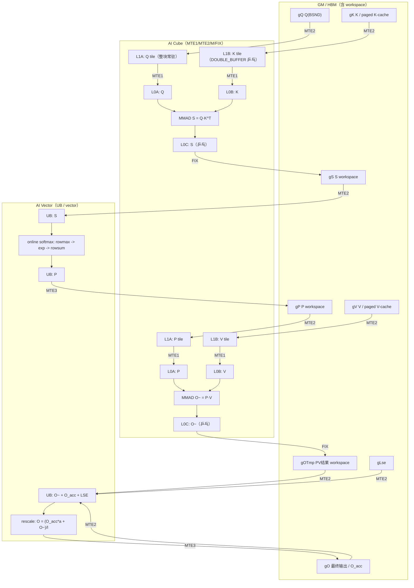
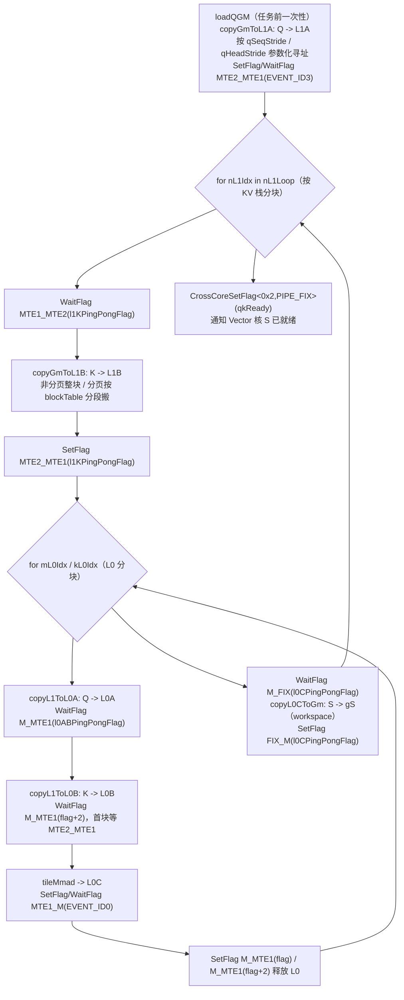
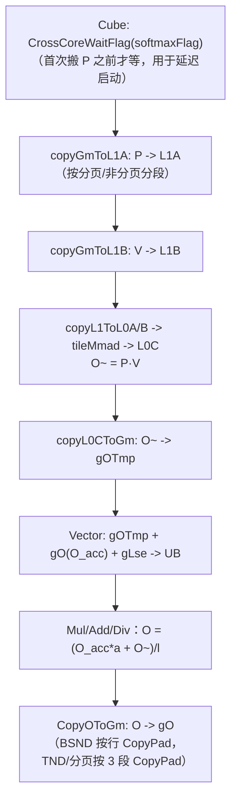
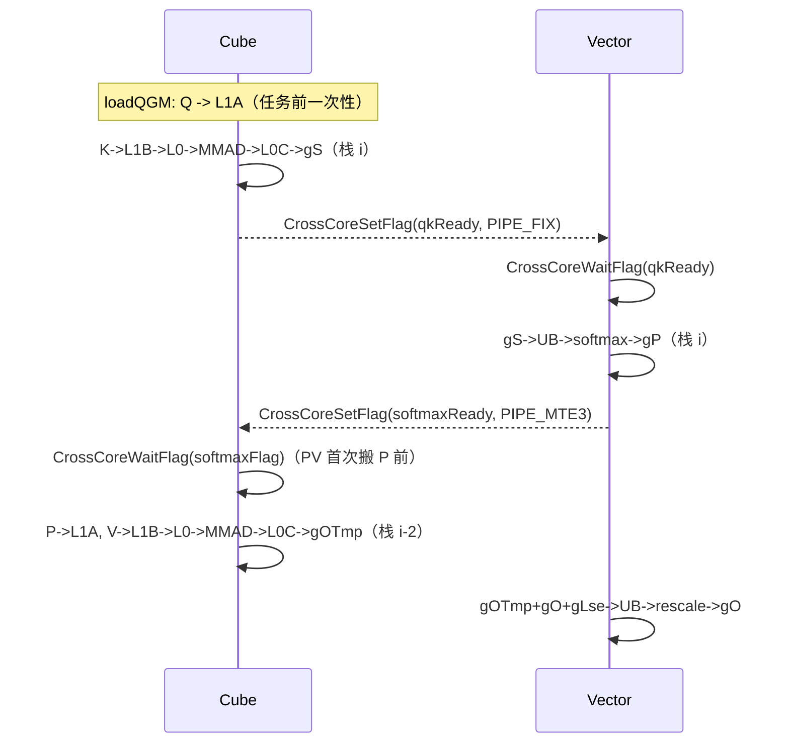
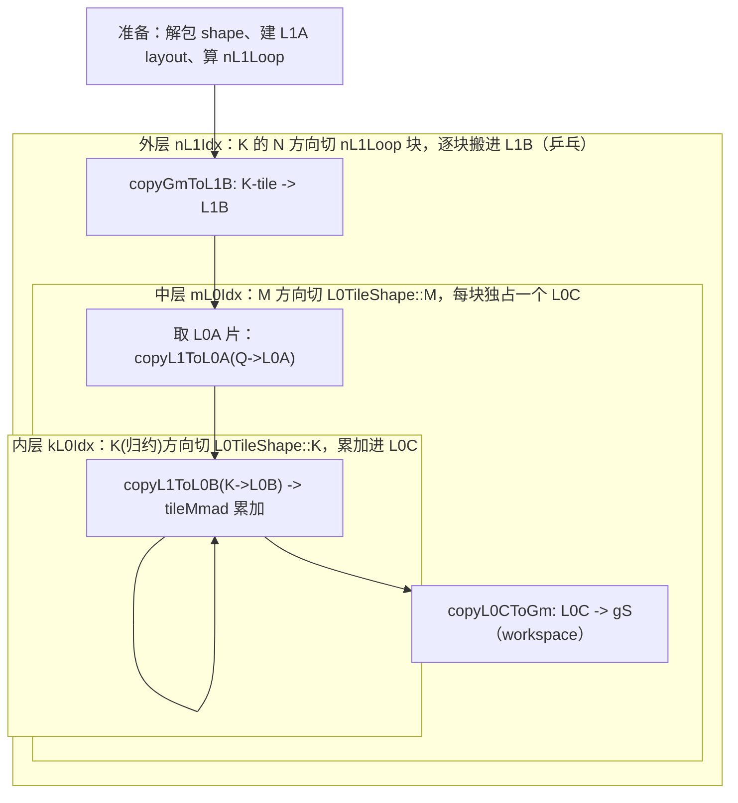
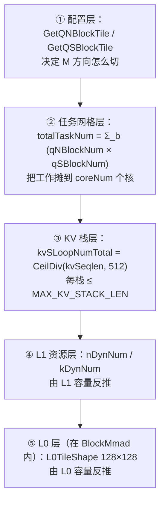
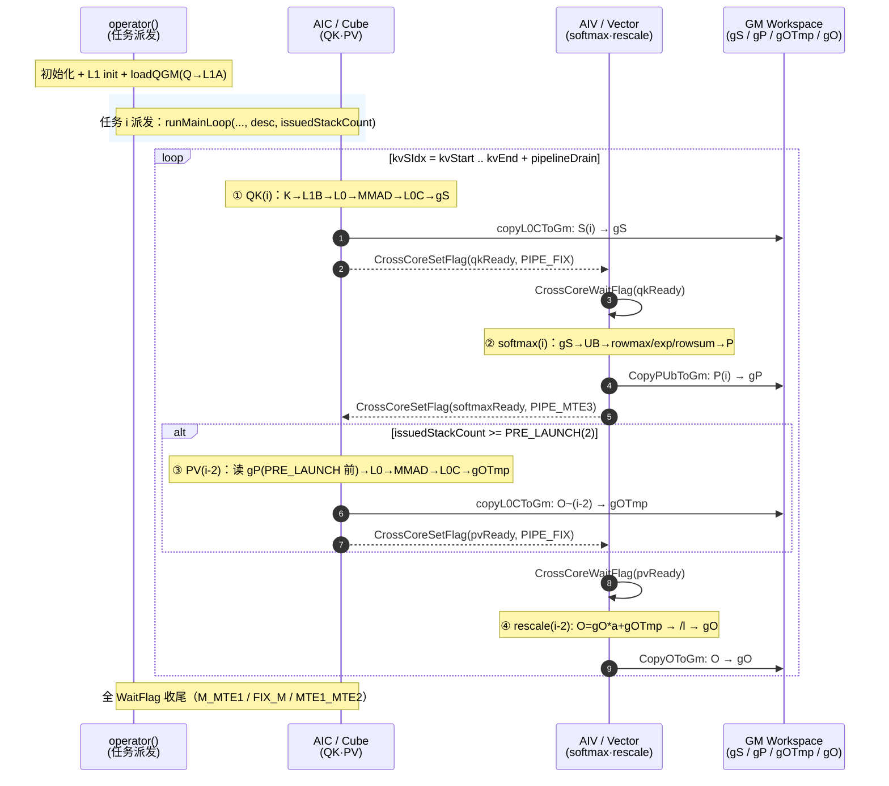
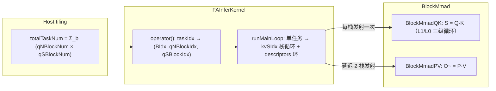

# 910 FAInferKernel 数据搬运与分块分析

> 分析对象：`csrc/ascend910/flash_attn_npu{,_3,_4}/`（以 `_3` 为主，v2 对照）
> 分析视角：昇腾 NPU 算子开发
> 分析日期：2026-10-15
> 关联文档：[PR223_BNSD支持实现方案分析.md](./PR223_BNSD支持实现方案分析.md)

---

## 目录

1. [结论摘要](#1-结论摘要)
2. [910 数据搬运动路](#2-910-数据搬运动路)
3. [关键概念逐条澄清](#3-关键概念逐条澄清)
4. [BlockMmad::operator() QK 主循环逐段解析](#4-blockmmadoperator-qk-主循环逐段解析)
5. [FAInferKernel 分块 tile 逻辑](#5-fainferkernel-分块-tile-逻辑)
6. [任务派发 → BlockMmad 完整调用链](#6-任务派发--blockmmad-完整调用链)
7. [遗留问题清单](#7-遗留问题清单)

---

## 1. 结论摘要

### 1.1 提交审查结论（merge `13cdb095`，PR#223 "support BNSD"）

该合并提交**不完善，且存在 P0 级阻塞缺陷**。

| 级别 | 问题 | 位置 |
|---|---|---|
| **P0** | `runMainLoop` 函数定义在合并中丢失，只剩孤悬函数体；文件无法编译 | [mha_fwd_kvcache.cpp L573](csrc/ascend910/flash_attn_npu_3/mha_fwd_kvcache.cpp)、v4 同 |
| **P0** | 同一函数存在**两份重复的 KV 栈循环副本**（按下标直算版 / descriptor 环版），bad-merge 残留 | L756-1150 与 L1367-1603 |
| P1 | 950 DN 路径未 stride 化，`enableDN` 要求 `is_contiguous()`，BNSD 场景静默退化为非 DN（性能回退） | [qk_matmul_DN.hpp](csrc/ascend950/flash_attn_npu_3/qk_matmul_DN.hpp) |
| P1 | 950 v4 的 FAG 反向 stride 路径未实现，测试直接 skip | [test_flash_attn_npu_v4.py L118](tests/test_flash_attn_npu_v4.py#L118) |
| P1 | `_is_bnsd_transpose_view` 只精确匹配一种 transpose 视图；反向仅覆盖 padded-batch | 各 interface 文件 |
| P2 | 合并残留重复代码（两套偏移计算：参数化版 vs 硬编码版） | qk_matmul / mha_fwd_kvcache |
| P2 | 参数化后 DMA stride 仍受 描述符位宽（≤UINT32_MAX）限制，host 侧无显式校验 | 各 flash_api.cpp |
| P2 | v2/v3/v4 × 910/950 共 5 套 matmul 手工同步，已出现改动不对称 | 5 份 `qk/pv_matmul.hpp` |

**对照证据（git）**

| 引用 | 状态 |
|---|---|
| `e378fb3`（main / merge-base） | v3 有 `__aicore__ inline bool runMainLoop(`（含 `uint32_t prevQSeqlenSum = 0;`） |
| `5d8d020`（PR#223 分支头） | v3 有 `void runMainLoop(`（L478）、v4 有（L448） |
| `13cdb095`（merge 结果 / HEAD） | **两者皆无定义**，仅有调用（v3 L428/L511；v4 L326/L392） |

### 1.2 设计本身评价

核心设计方向**正确**：

- stride 参数化（batch/seq/head 三元组作为 launch 参数）；
- 偏移量 U32→U64 防溢出；
- 分页 KV 引入 `blockStrideKV`；
- appendKV 读 stride 与写 cache stride 解耦；
- 950 分页 `pageOffset` 张量重建。

**不变量**：连续 BSND 下这些 stride 退化为改造前的硬编码值，行为**比特一致**。

---

## 2. 910 数据搬运动路

910 是 **Cube 核 / Vector 核分离**架构。矩阵乘在 Cube 完成（L1→L0→MMAD→L0C），中间结果落 GM workspace，再交 Vector 核做 softmax / rescale。

### 2.1 端到端通路



**要点**

- 搬运单位沿 `EMBED_SPLIT_SIZE=128` / `KV_SPLIT_SIZE=128` / `L1TileShape` 分块。
- **L1 区域复用**：QK 的 B 区（K）与 PV 的 A 区（P）复用同一块 L1（`L1_QK_SIZE` 同时是 PV 的 `l1BufAddrStart`）。
- **三级乒乓**：`l1KPingPongFlag`、`l0ABPingPongFlag`、`l0CPingPongFlag`，共享 `pingPongState`。

### 2.2 QK 矩阵乘内部搬运与事件

Q tile 只搬一次（进入 KV 循环前），K 按 KV 栈逐块搬入。



### 2.3 Softmax（Vector 核，GM→UB→GM）

S 不在核内直连，必须落 GM workspace 再回读：

1. `gS → UB`（`DataCopy`）；
2. `BlockReduceMax` 求行 max，`Exp` 求指数，`BlockReduceSum` 求行和（[online_softmax.hpp](csrc/ascend910/flash_attn_npu_3/online_softmax.hpp)）；
3. `CopyPUbToGm` 把 P 写回 `gP`；
4. `Arch::CrossCoreSetFlag<0x2, PIPE_MTE3>(softmaxReady)`。

### 2.4 PV + RescaleO



### 2.5 跨核同步时序（软件流水）

PV 被**延迟 `PRE_LAUNCH(2)` 个栈**发射，形成 Cube 3 段流水。



### 2.6 appendKV 额外支路

当 `appendKV`（`kvNewSeqlen != 0`）时，new-K 的 L1B tile 会**额外**经 ND 中转回写进 KV cache：

```
gKNew --GM-> L1B(Cube) --> ndCopyTensor(L1 ND) --DataCopy--> gK / K-cache
                                                        （分页时按 cachePageSize 分段、查 gCacheTable）
```

对应实现：`writebackK` / `storeKToCache`；PV 侧同理回写 new-V。

---

## 3. 关键概念逐条澄清

### 3.1 `init()`：资源绑定，不做计算

```cpp
void init(Arch::Resource<ArchTag> &resource, uint32_t nDyn, uint32_t kDyn,
          uint32_t KVStackLen = 512, uint32_t l1BufAddrStart = 0,
          uint32_t ndCopyBufAddr = 0)
```

把 AscendC 预分配的 L1 / L0A / L0B / L0C 物理 Buffer 按 tiling 尺寸切分出逻辑 Tensor，每个 AI Core 启动时调用一次。

| 参数 | 含义 |
|---|---|
| `nDyn` | 动态 **N** tile 大小（KV 方向） |
| `kDyn` | 动态 **K** tile 大小（head_dim） |
| `KVStackLen` | 单 KV 栈容量，默认 512，存为 `maxKVStackLen` |
| `l1BufAddrStart` | 本块在 L1 的起始字节偏移——让 QK 与 PV 共享 L1 |
| `ndCopyBufAddr` | appendKV 回写专用 ND 中转区；为 0 表示不分配 |

**L1 布局**

```
L1 Buffer（本块视角）
┌──────────────────────────────┬─────────────────┬─────────────────┐
│ A 区 = Q tile                │ B[0] = K stage0 │ B[1] = K stage1 │
│ L1TileShape::M * kDyn        │ nDyn * kDyn     │ nDyn * kDyn     │
│ * sizeof(ElementA)           │ * sizeof(ElmB)  │ * sizeof(ElmB)  │
└──────────────────────────────┴─────────────────┴─────────────────┘
 ^ l1BufAddrStart                              ...（PV 的 A 区从这里往后接）
```

**设计要点**

1. 地址是"字节偏移 + 外部传入"，让 QK 用 `[0, L1_QK_SIZE)`、PV 用 `[L1_QK_SIZE, …)`；
2. **A 单缓冲 / B 双缓冲**：Q 整任务复用，K 每栈必换；
3. 尺寸用 `sizeof(ElementA)` vs `sizeof(ElementB)` 区分，为 Q/K 不同精度预留；
4. `ndCopyBufAddr` 是可选资源，避免常态浪费 L1。

### 3.2 `l1NDynamic` / `l1KDynamic`

GEMM 位置命名法：`X ∈ {M,N,K}` 指**该 GEMM 的第 X 维**，`Dynamic` 表示 L1 分块粒度是运行时由 tiling 算出。

| 成员 | QK：`S[M,N] = Q[M,K]·Kᵀ` | PV：`O~[M,N] = P[M,K]·V` |
|---|---|---|
| `l1NDynamic` | KV 栈方向（N） | `embedV`（N） |
| `l1KDynamic` | `embed`（归约维 K） | KV 栈方向（K） |

- **QK 中** `l1KDynamic` 只赋值不使用（K = embed 已被 `kDynNum` 整体覆盖，L0 级用编译期常量 `L0TileShape::K`）。
- **PV 中** `l1KDynamic` 真正生效（`kL1Loop = CeilDiv(stackSeqTile, l1KDynamic)`）。
- `l1MDynamic` 声明为 0 且全程未用——M 方向统一用 `L1TileShape::M`。

**取值来源（host tiling）**

```
kDynNum      = max(RoundUp(embed, 128), 256)
maxQKPL1Size = L1_MAX_SIZE - embedV*512*sizeof(ElementV)
maxQL1Size   = 128 * kDynNum * sizeof(ElementQ)
maxNDynNum   = ((maxQKPL1Size - maxQL1Size)/kDynNum/sizeof(ElementV)/2)/32*32
nDynNum      = min(maxNDynNum, L1_MAX_N_NUM=128)，32 对齐
kPVDynNum    = nDynNum * kDynNum / L1TileShape::M
```

### 3.3 `l1NDynamic` 是"分块大小"而非"块数"

量纲为**元素个数**。判据：

| 用法 | 说明 |
|---|---|
| `nL1Loop = CeilDiv(stackSeqTile, l1NDynamic)` | **大小÷大小 = 块数** |
| `nSplitSize = stackSeqTile - nL1Idx * l1NDynamic` | 乘减，得尾块**长度** |
| `nowNIdx * l1NDynamic * strideKV` | 地址步进，长度量纲 |
| `tileNNumPerBaseBlock = blockSize / l1NDynamic` | 用它当**除数**得"每 page 几个 tile" |
| `nL1Idx * l1NDynamic` 作 `gmCTileCoord` 列坐标 | 坐标是长度量纲 |

对照关系：

```
stackSeqTile (=512)  ──按 l1NDynamic (=nDynNum) 切──►  nL1Loop 个 tile
   ├─ tile 0 : 大小 l1NDynamic
   ├─ tile 1 : 大小 l1NDynamic
   └─ tile nL1Loop-1 : 大小 stackSeqTile - (nL1Loop-1)*l1NDynamic   ← 尾块
```

### 3.4 `LayoutQ layoutQTemp(rowNum, embed)` 是 (行, 列) 而非乘积

Catlass/tla 的 layout 构造签名为 `Layout(row, col, ld)`：

| layout | 默认 ld | 元素 (i,j) 地址 |
|---|---|---|
| `RowMajor(row, col, ld=col)` | `col` | `i*ld + j` |
| `ColumnMajor(row, col, ld=row)` | `row` | `j*ld + i` |

- `LayoutQ layoutQTemp(rowNum, embed)` = **rowNum 行 × embed 列**，默认 `ld = embed`；
- 元素总数 `= rowNum * embed`，**仅因 ld 缺省为 col 才等于乘积**；
- **证据**：同文件 `LayoutS layOutS(rowNum, desc.stackSeqTile, stackSeqTilePad)` 显式传第三个 ld 参数；`loadQGM` 内 `embed = layoutA.shape(1)` 取的就是构造时传入的**列数**。

### 3.5 `ld`（leading dimension）是什么

行主序/列主序矩阵在内存里"相邻两行（列）起点之间的元素间距"，用于解耦"逻辑形状"与"物理内存"。

```
RowMajor:    offset = i * ld + j
ColumnMajor: offset = j * ld + i
```

三类用法：

1. **紧凑行主序**：`RowMajor(3,4,4)`，ld = col = 4；
2. **带 padding / 子矩阵**：`RowMajor(3,4,8)`，行间留空（对齐、防 bank 冲突）；
3. **本仓库 K**：`LayoutK layoutKTemp(strideK, stackSeqTile)`，K 是 `ColumnMajor`，`ld` 默认取第一参 → `strideK` 直接成为 ld，即"相邻 seq 在 GM 上的元素间距"。

**与 stride 的区别**：`ld` 只是 stride 的一种特例，**只描述一个维度**。单层 stride（K）→ 一个 ld 够用；多层 stride（Q 的 head + token）→ 一个 ld 装不下，必须显式传两个标量。

### 3.6 `loadQGM` 的作用

把 Q 的一个 tile 从 GM 搬进 L1 的 A 区。每 task 只调用一次（Q 全程复用）。

**实参 → 形参映射**

| 实参 | 形参 | 含义 |
|---|---|---|
| `gQ[gmOffsetQ]` | `gA` | Q 在 GM 的起始地址 |
| `layoutQTemp` | `layoutA` | Q 的 `(rowNum, embed)` 行主序布局 |
| `rowNum` | `rowNum` | tile 行数 = `qSBlockSize × qNBlockSize` |
| `qNBlockSize` | `singleGroupHeads` | 单 token 搬几个 head |
| `strideQ` | `qSeqStride` | 相邻 q-token 的 GM 元素步长 |
| `qHeadStride` | `qHeadStride` | 相邻 head 的 GM 元素步长 |

**核心：二维抽象**

```cpp
LayoutA layoutSingleANd(singleGroupHeads, embed, qHeadStride);
copyGmToL1A(l1ATensor, gA, layoutAInL1, layoutSingleANd,
            tokenNumPerGroup, qSeqStride, tokenNumPerGroup, BLOCK_SIZE, rowNumRound);
SetFlag<MTE2_MTE1>(EVENT_ID3); WaitFlag<MTE2_MTE1>(EVENT_ID3);
```

把 Q 看成 `tokenNumPerGroup` 个 token，每个 token 是一个 `(singleGroupHeads, embed)` 的 ND 小矩阵，矩阵内行步长 = `qHeadStride`，token 间 = `qSeqStride`。

末尾 `SetFlag + WaitFlag(MTE2_MTE1, EVENT_ID3)` 是**一次性硬同步**：等 MTE2 搬完，之后 MTE1 读 L1 才安全。

### 3.7 BNSD 注释解读（`qHeadStride` / `qSeqStride`）

```cpp
// One ND matrix is a group of heads for one token. qHeadStride
// describes rows within that matrix and qSeqStride separates tokens;
// this directly handles e.g. BHSD.transpose(1, 2) without materializing.
```

Q tile 不是一个"整齐的行主序矩阵"，而是"多个小矩阵的拼接"，必须用**两层 stride** 描述：

```
             ┌──────────── embed 列（stride = 1，连续）────────────┐
 token 0 ├─ head 0 ──► [ d0 d1 d2 ... ]
         │     ↑ qHeadStride            ← 小矩阵内部：行间跳 qHeadStride
         ├─ head 1 ──► [ d0 d1 d2 ... ]
         │
         │  ↑ qSeqStride                ← 小矩阵之间：跳 qSeqStride
         │
 token 1 ├─ head 0 ──► [ d0 d1 d2 ... ]
         └─ head 1 ──► [ d0 d1 d2 ... ]
```

对 `BNSD.transpose(1,2)` 得到的 BSND 视图（stride `(H*S*D, D, S*D, 1)`）：

- head 维 stride = `S*D` → `qHeadStride`
- seq 维 stride = `D` → `qSeqStride`

于是 DMA 直接按这两个跳读地址把数据搬成 L1 里连续的 `(rowNum, embed)`，**不必物化 contiguous 副本**。

**退化保证**：连续 BSND 下 `qHeadStride = embed`、`qSeqStride = embed × singleGroupHeads`，两层合成即整块连续搬运，与改造前一致。

> 注意 BNSD 视图下 head 与 seq 的 stride 关系是"反的"（head 隔得远、token 隔得近），这正是不能靠单一 `ld` 描述的原因。

### 3.8 `nL1Loop = CeilDiv(stackSeqTile, l1NDynamic)`

**本次 KV 栈需要分几个 L1 tile 来搬 K**，即 `for (nL1Idx = 0; nL1Idx < nL1Loop; ++nL1Idx)` 的循环次数。

必须向上取整 + 配尾块处理（`nSplitSize = stackSeqTile - nL1Idx * l1NDynamic`），否则漏搬尾部数据。

| stackSeqTile | l1NDynamic | nL1Loop | 各 tile 实际长度 |
|---|---|---|---|
| 512 | 128 | 4 | 128, 128, 128, 128 |
| 500 | 128 | 4 | 128, 128, 128, **116** |
| 300 | 256 | 2 | 256, **44** |

**层级定位**：外层是 KV 栈循环（`kvSIdx`），`nL1Loop` 是**内层**——把"一个 KV 栈"再切成 L1 装得下的若干块。

### 3.9 `copyGmToL1B` 是否也要加 stride？

**K 也需要 stride，但已通过 `layoutB` 参数带进去**，无需再加标量。

**关键差异：Q 的 tile 跨多个 head，K 的 tile 只含一个 head。**

| | Q（A） | K（B） |
|---|---|---|
| tile 形状 | `rowNum × embed`，跨多 head | `embed × nActual`，单 head |
| 行方向 stride | **两层**：token 内 = `qHeadStride`，token 间 = `qSeqStride` | **一层**：seq stride = `strideK` |
| 单个 2D layout 的 ld 能否表达 | ❌ 不能 | ✅ 能 |

一个普通 2D 行主序 layout 只有一个 `ld`，无法同时表达"head 间 stride"和"token 间 stride"两个自由度，所以 Q 必须传两个标量并在 `loadQGM` 内部自建 `LayoutA layoutSingleANd(singleGroupHeads, embed, qHeadStride)`。

K 的分配方式：

- **seq stride** → 走 `layoutB` 的 ld（`layoutKTemp(strideK, stackSeqTile)`）；
- **head / batch stride** → 走偏移通道（`gmOffsetK = kBOffset + kvNIdx * kHeadStride`）。

**主分支旧代码为何不够**：`e378fb3` 的 `loadQGM` 用 `layoutA.GetTileLayout(MakeCoord(singleGroupHeads, embed))` 从 `LayoutQ layoutQTemp(rowNum, embed)`（ld = embed）派生子布局，隐含断言 **head stride = embed**——对连续 BSND 成立，对 `BNSD.transpose(1,2)` 视图（head stride = S*D）就错了。K 那边没有这个假设，所以不用改。

### 3.10 为什么 K 是 `layout::ColumnMajor`

**是，本质就是 `S = Q·Kᵀ` 里的那个转置**，但它是**逻辑转置，不是物理转置**。

**从 GEMM 口径看**：Cube 只认 `C(M,N) = A(M,K_red)·B(K_red,N)`。

| GEMM 维 | 对应 | 大小 |
|---|---|---|
| `M` | Q 的行（q token × 组内 head） | `rowNum` |
| `N` | KV 的 seq | `stackSeqTile` |
| `K_red` | head_dim | `embed` |

→ **B 必须是 `(K_red, N) = (D, Sk)`**，而内存里的 K 是 `(Sk, D)`。**B = Kᵀ**。

**`ColumnMajor` 如何免费表达转置**

```
RowMajor(M, N, ld=N)      : offset(i,j) = i*ld + j
ColumnMajor(M, N, ld=M)   : offset(i,j) = j*ld + i
```

K 声明为 `ColumnMajor`、形状 `(D, Sk)`：`offset(k, n) = n*ld + k`
内存真实地址（`(Sk, D)` 行主序）：`addr(n, k) = n*D + k`
两者**逐元素相等**（`ld = D`）→ 读出来就是 `Kᵀ`，**一个字节不用动**。

```cpp
LayoutQ layoutQTemp(rowNum, embed);         // Q: (M, D)，RowMajor
LayoutK layoutKTemp(strideK, stackSeqTile); // K: (D, Sk)，ColumnMajor ← 第一参充当 ld
LayoutV layoutVTemp(stackSeqTile, strideV); // V: (Sk, D)，RowMajor
```

**注意参数的翻转**正是转置的痕迹（K 把 `strideK` 放第一参，V 把 `stackSeqTile` 放第一参），与 `using LayoutK = layout::ColumnMajor;` / `using LayoutV = layout::RowMajor;` 严格配对。

**"在哪里转置"** —— 融合在两处，无独立步骤：

1. **布局声明处**（`using LayoutK = layout::ColumnMajor;`）——只给寻址解释；
2. **GM→L1 的 DMA 里**——`layoutB.GetTileLayout(MakeCoord(kActual, nActual))` 生成源端视图，`copyGmToL1B(..., layoutBInL1, layoutBTile)` 读入并写进 L1 的 **NZ/分形**布局。**转置与格式转换合并进同一次 DMA**。

**为什么 Q/V 不用**：

| 张量 | GEMM 角色 | 需转置 | layout |
|---|---|---|---|
| Q | A `(M, D)` | 否 | `RowMajor` |
| **K** | B `(D, N)` = **Kᵀ** | **是** | **`ColumnMajor`** |
| V | B `(Sk, D)` | 否（`O=P·V` 无转置） | `RowMajor` |

**与 BNSD 改造的呼应**：无论 BSND 还是 `BNSD.transpose(1,2)`，K 的最后一维 D 始终连续、seq 方向 stride 始终为 D，所以 `ColumnMajor + ld=strideK` 在两种布局下同时成立 → **K 天然兼容，无需改动**。

### 3.11 `Gemm::Block::BlockMmad` 是什么

Catlass 库的**块级 GEMM 主循环抽象类模板**，把"GM→L1→L0→MMAD→L0C→GM"封装成一个**仿函数对象**。

**分层**：`Tile`（原语）→ **`Block`**（一个 tile 的完整 GEMM 主循环）→ `Kernel`（整体算子）。

**模板参数**（9 个，本项目只用前 6 个）

| # | 参数 | 含义 | QK 实参 |
|---|---|---|---|
| 1 | `DispatchPolicy` | 分发策略（含 ArchTag、STAGES、PAGED_CACHE），兼作特化标签 | `MmadAtlasA2FAIQKT<...>` |
| 2 | `L1TileShape` | L1 分块 `<M,N,K>` | `GemmShape<Q_TILE_CEIL,128,128>` |
| 3 | `L0TileShape` | L0 分块 | `GemmShape<128,128,128>` |
| 4-6 | `AType/BType/CType` | 矩阵类型（Element + Layout） | Q/K/S |
| 7-9 | `BiasType/TileCopy/TileMmad` | 省略，走默认 | — |

**核心机制：靠 DispatchPolicy 打标签的部分特化**

```cpp
// qk_matmul.hpp
struct BlockMmad<MmadAtlasA2FAIQKT<PAGED, UNIT>, ...> { ... };
// pv_matmul.hpp
struct BlockMmad<MmadAtlasA2FAIPVT<PAGED, UNIT>, ...> { ... };
```

| 实例 | DispatchPolicy | A / B / C | 实现文件 | GEMM |
|---|---|---|---|---|
| `BlockMmadQK` | `MmadAtlasA2FAIQKT` | Q / K / S | `qk_matmul.hpp` | `S = Q·Kᵀ` |
| `BlockMmadPV` | `MmadAtlasA2FAIPVT` | P / V / OTmp | `pv_matmul.hpp` | `O~ = P·V` |

**对外成员**

| 成员 | 作用 |
|---|---|
| `init(resource, nDyn, kDyn, ...)` | 绑定 L1/L0 Buffer |
| `loadQGM(...)` | Q → L1A（每任务一次） |
| `operator()(gA,gB,gC,layouts,shape,...)` | 核心主循环 |
| `resetBlockStart(...)` | 复位分页 block 游标 |
| `SetPingPongState(...)` | 接入乒乓状态 |

**架构意义**：上层 Kernel 通过模板参数注入，可整体替换实现（如 950 的 DN 版 `qk_matmul_DN.hpp`），这就是同一个 `BlockMmad` 名字在本仓库对应 5 套文件的原因。

---

## 4. BlockMmad::operator() QK 主循环逐段解析

目标：`S[rowNum, stackSeqTile] = Q[rowNum, embed] · Kᵀ[embed, stackSeqTile]`

### 4.0 整体骨架



| 层级 | 循环变量 | 切分对象 | tile 大小 |
|---|---|---|---|
| 外 | `nL1Idx` | KV 的 **N**（seq） | `l1NDynamic`（L1 容量反推） |
| 中 | `mL0Idx` | **M**（q token×组内head） | `L0TileShape::M = 128` |
| 内 | `kL0Idx` | **K**（head_dim 归约） | `L0TileShape::K = 128` |

> 坐标约定：`actualOriShape = {rowNum(M), stackSeqTile(N), embed(K)}`。**注意 `kActual` 是 embed（归约维），不是 KV 长度**。

### 4.1 入参与状态暂存

```cpp
(void)doCopyback; (void)gBCache; ...      // 显式抑制"未使用"警告
appendDoCopyback = doCopyback;            // appendKV 写回状态存成成员
appendGBCache = gBCache;
appendCacheStride = cacheStrideKV;
appendCacheBlockStride = cacheBlockStrideKV;
```

**读侧参数被 `(void)` 掉，只作为成员保存**——真正的 K 回写发生在 `writebackK()` 里。这里是**读 stride 与写 stride 解耦**的落点。

### 4.2 形状解包 + D 过大分流

```cpp
uint32_t rowNum       = actualOriShape[COORD_DIM0];   // M
uint32_t stackSeqTile = actualOriShape[COORD_DIM1];   // N
uint32_t embed        = actualOriShape[COORD_DIM2];   // K
if (embed > EMBED_SPLIT_SIZE * 2U) {                  // 256
    headDimSplitQK(...); return;                      // D=512 走另一条路
}
```

### 4.3 循环前准备

```cpp
GemmCoord actualShape{rowNum, 0, embed};               // N 先填 0，每轮更新
uint64_t gBOffset = 0;
LayoutAInL1 layoutAInL1 = LayoutAInL1::MakeLayout(rowNum, embed);

uint32_t tileNNumPerBaseBlock = blockSize / l1NDynamic;
uint32_t nL1Loop = CeilDiv(stackSeqTile, l1NDynamic);
if constexpr (PAGED_CACHE_FLAG_) {
    blockStart = blockSize - blockStartOffset;
    setBlockParam(stackSeqTile, blockStart, blockEnd, curBlockTotalNum, blockSize);
}
```

`setBlockParam` 算出**分页首块的对齐余量** `blockStartOffset`、尾块 `blockEnd`、总块数 `curBlockTotalNum`——上次调用可能停在 page 中途，这次接着走。

### 4.4 外层：把 K 搬进 L1B

**公共动作**

```cpp
LayoutBInL1 layoutBInL1 = LayoutBInL1::MakeLayout(kActual, nActual);
l1KPingPongFlag = pingPongState->l1PingPongFlag;
pingPongState->l1PingPongFlag = 1U - l1KPingPongFlag;
```

乒乓状态放在 `pingPongState` 里**跨调用传递**。

**分支 A：`cachePageSize != 0` —— appendKV 读连续新 K**

```cpp
getBlockShape(actualShape, nL1Idx, nL1Loop, stackSeqTile);
getKVOffset(gBOffset, nIdx, nL1Idx, strideKV);          // 非分页公式
WaitFlag<MTE1_MTE2>(l1KPingPongFlag);
copyGmToL1B(l1BTensor[flag], gB[gBOffset], layoutBInL1, layoutBTile);
SetFlag<MTE2_MTE1>(l1KPingPongFlag);
writebackK(gB, gBOffset, nL1Idx, nActual, kActual, strideKV);  // 写回分页 cache
```

`gB` 是**连续的新 K**故整块搬；**写回**才分页，交给 `writebackK`。

**分支 B：`cachePageSize == 0` —— 从分页 cache 逐页搬**

```cpp
uint32_t l1NResDynamic = (nL1Idx < nL1Loop-1) ? l1NDynamic : (stackSeqTile - nL1Idx*l1NDynamic);
uint32_t kvL1Len = 0;
WaitFlag<MTE1_MTE2>(l1KPingPongFlag);
while (kvL1Len < l1NResDynamic) {                       // 把多个 page 拼满一个 L1 tile
    uint32_t curBlockSize = (curBlockIdx < curBlockTotalNum-1) ? blockSize : blockEnd;
    uint32_t nowNIdx = nIdx * maxKVStackLen / blockSize + curBlockIdx;
    getBlockShape(actualShape, blockStartOffset, l1NResDynamic, kvL1Len, nowLen, curBlockSize);
    getKVOffset(gBlockTable, gBOffset, nowNIdx, blockStartOffset, strideKV, blockStrideKV);
    auto layoutBTile = layoutB.GetTileLayout(MakeCoord(embed, nowLen));
    MatrixCoord l1BTileCoord{0, kvL1Len};
    auto l1BTile = l1BTensor[flag][layoutBInL1.GetOffset(l1BTileCoord)];
    copyGmToL1B(l1BTile, gB[gBOffset], layoutBInL1, layoutBTile);
    kvL1Len += nowLen;
    updateBlockOffset(nowLen, curBlockIdx, blockSize);
}
SetFlag<MTE2_MTE1>(l1KPingPongFlag);
```

**分页核心**：

- `gBlockTable.GetValue(nowNIdx)` 逻辑页 → 物理块号 `blockTableId`；
- 地址 = `blockTableId * blockStrideKV + startOffset * strideKV` —— **页间 stride 与页内行 stride 解耦**；
- 内层 `while` 把**跨页的多个小段拼进同一个 L1B buffer 的连续 N 区间**；
- 页边界用 `updateBlockOffset` 推进，跨调用保持 `blockStartOffset`。

**分支 C：非分页** —— 算尾块、算偏移、一次 `copyGmToL1B`；若 appendKV 则 `writebackK`。

### 4.5 中层 `mL0Idx`：M 方向切块

```cpp
uint32_t mL0Loop = CeilDiv(mActual, L0TileShape::M);
for (mL0Idx ...) {
    uint32_t mL0Actual = (mL0Idx < mL0Loop-1) ? L0TileShape::M : (mActual - mL0Idx*L0TileShape::M);
    l0CPingPongFlag = pingPongState->l0CPingPongFlag;
    pingPongState->l0CPingPongFlag = 1U - l0CPingPongFlag;
    WaitFlag<FIX_M>(l0CPingPongFlag);
```

**M 方向每块独占一个 L0C**——L0C 容量装不下整个 `rowNum × nActual`。

### 4.6 内层 `kL0Idx`：K 归约维切块 + MMAD 累加

```cpp
uint32_t kL0Loop = CeilDiv(kActual, L0TileShape::K);     // kActual = embed
for (kL0Idx ...) {
    l0ABPingPongFlag = pingPongState->l0ABPingPongFlag;
    pingPongState->l0ABPingPongFlag = 1U - l0ABPingPongFlag;
    uint32_t kL0Actual = ...;

    // A: Q 从 L1A 下到 L0A
    LayoutAInL0 layoutAInL0 = LayoutAInL0::MakeLayout(mL0Actual, kL0Actual);
    MatrixCoord l1ATileCoord{mL0Idx*L0TileShape::M, kL0Idx*L0TileShape::K};
    auto l1ATile = l1ATensor[layoutAInL1.GetOffset(l1ATileCoord)];
    WaitFlag<M_MTE1>(l0ABPingPongFlag);
    copyL1ToL0A(l0ATensor[l0ABPingPongFlag], l1ATile, layoutAInL0, layoutAInL1);

    // B: K 从 L1B 下到 L0B
    LayoutBInL0 layoutBInL0 = LayoutBInL0::MakeLayout(kL0Actual, nActual);
    MatrixCoord l1BTileCoord{kL0Idx*L0TileShape::K, 0};
    auto l1BTile = l1BTensor[l1KPingPongFlag][layoutBInL1.GetOffset(l1BTileCoord)];
    if (mL0Idx==0 && kL0Idx==0) WaitFlag<MTE2_MTE1>(l1KPingPongFlag);  // 首次才等 K 搬完
    WaitFlag<M_MTE1>(l0ABPingPongFlag + 2U);
    copyL1ToL0B(l0BTensor[l0ABPingPongFlag], l1BTile, layoutBInL0, layoutBInL1);
    if (末块) SetFlag<MTE1_MTE2>(l1KPingPongFlag);         // 全部读完后释放 L1B

    // MMAD
    SetFlag<MTE1_M>(EVENT_ID0); WaitFlag<MTE1_M>(EVENT_ID0);
    bool initMmad = (kL0Idx == 0U);                        // 首个 k 块清零累加器
    uint32_t mL0Align = RoundUp(mL0Actual, BLOCK_SIZE);
    tileMmad(l0CTensor[l0CPingPongFlag], l0ATensor[..], l0BTensor[..], mL0Align, nActual, kL0Actual, initMmad);
    SetFlag<M_MTE1>(l0ABPingPongFlag);
    SetFlag<M_MTE1>(l0ABPingPongFlag + 2U);
}
```

| 细节 | 说明 |
|---|---|
| **`initMmad = (kL0Idx==0)`** | K 方向多块**累加**到同一 L0C，只有第一块清 L0C |
| **`mL0Align`** | 16 对齐，满足 Cube 的 M 方向对齐要求 |
| **`l1ATileCoord` 含 `mL0Idx`** | Q 在 L1A 是常驻大块，内外层坐标都要用 |
| **事件分槽** | L0A 用 `flag`(0/1)、L0B 用 `flag+2`(2/3)，A/B 乒乓互不干扰 |
| **L1B 门控很省** | 只在 `(0,0)` 等一次、末块放一次——K 的 L1B 是按 N 块整体就绪的 |

### 4.7 L0C 写回 GM

```cpp
SetFlag<M_FIX>(EVENT_ID0); WaitFlag<M_FIX>(EVENT_ID0);
MatrixCoord gmCTileCoord{mL0Idx*L0TileShape::M, nL1Idx*l1NDynamic};
LayoutC layoutCTile = layoutC.GetTileLayout(MakeCoord(mL0Actual, nActual));
auto layoutInL0C = LayoutCInL0::MakeLayoutInL0C(MakeCoord(mL0Actual, nActual));
copyL0CToGm(gC[layoutC.GetOffset(gmCTileCoord)], l0CTensor[..], layoutCTile, layoutInL0C);
SetFlag<FIX_M>(l0CPingPongFlag);
```

- **列基址 = `nL1Idx * l1NDynamic`**：S 的 N 方向按 L1 tile 分块写回；
- **行基址 = `mL0Idx * L0TileShape::M`**；
- `LayoutCInL0 = layout::zN`——L0C 是分形格式，`MakeLayoutInL0C` 负责反解成 C 的逻辑坐标。

### 4.8 同步事件总表

| 事件 | 配对 | 保护对象 | 位置 |
|---|---|---|---|
| `MTE1_MTE2(l1KPingPongFlag)` | W → S | **L1B**：MTE1 读完 → MTE2 才可覆写 | 每 L1 tile |
| `MTE2_MTE1(l1KPingPongFlag)` | S → W | **L1B**：MTE2 写完 → MTE1 才可读 | 首次 L0 块 |
| `M_MTE1(l0ABPingPongFlag)` | W → S | **L0A**：MMAD 用完 → MTE1 才可覆写 | 每 k 块 |
| `M_MTE1(l0ABPingPongFlag+2)` | W → S | **L0B** | 每 k 块 |
| `MTE1_M(EVENT_ID0)` | S → W | A/B 都到 L0 → MMAD 启动 | 每 k 块 |
| `M_FIX(EVENT_ID0)` | S → W | MMAD 完成 → FIX 搬 L0C | 每 M 块 |
| `FIX_M(l0CPingPongFlag)` | W → S | FIX 搬完 → MMAD 复用 L0C | 每 M 块 |

三段乒乓源头都是 `pingPongState`——**状态外置、跨调用持继**，保证同一 KV 栈被切成多次调用时乒乓不乱。

### 4.9 三个设计要点

1. **循环层次 = 硬件层级**：L1（外）→ L0C（中）→ L0A/B（内）；
2. **同步粒度差异化**：L1B 按 N 块整体就绪（省 flag），L0A/L0B 必须每 k 块同步；
3. **stride 全程参数化**：读侧 stride 与写侧 cache stride 分离。

---

## 5. FAInferKernel 分块 tile 逻辑

> ⚠️ 分块逻辑横跨两个函数：任务网格层在 `operator()`（完好），单任务内分块在 `runMainLoop()`（**定义丢失，见遗留问题**）。

### 5.1 五级分块总览



| 级别 | 切分对象 | 粒度 | 约束来源 |
|---|---|---|---|
| ① | Q 序列 × head 组 | 合成 128 | **L0/L1 的 M 上限**（`Q_TILE_CEIL`） |
| ② | (batch, kv-head组, q-seq块) | 1 个任务 | **核数** `coreNum` |
| ③ | KV 序列 | `512` | **workspace**（`128×512` 槽） |
| ④ | KV 栈内 N | `l1NDynamic` | **L1 容量** |
| ⑤ | M/N/K | `L0TileShape` | **L0A/L0B/L0C 容量** |

### 5.2 ① 配置层：`GetQNBlockTile` / `GetQSBlockTile`

```cpp
uint32_t GetQNBlockTile(uint32_t qSeqlen, uint32_t groupSize) {
    uint32_t qNBlockTile = (qSeqlen != 0) ?
        (Q_TILE_CEIL / qSeqlen) / N_SPLIT_HELPER * N_SPLIT_HELPER   // (128/S)/2*2
        : Q_TILE_CEIL;
    qNBlockTile = qNBlockTile < groupSize ? qNBlockTile : groupSize;
    qNBlockTile = qNBlockTile < 1 ? 1 : qNBlockTile;
    return qNBlockTile;
}
uint32_t GetQSBlockTile(uint32_t kvSeqlen) { return Q_TILE_CEIL; }  // 恒 128
```

**核心思想：M 方向是一个固定的 ~128 预算，在 S 和 N 两轴上分配。**

`rowNum = qSBlockSize × qNBlockSize`：

| qSeqlen | groupSize | qSBlockTile | qNBlockTile | rowNum |
|---|---|---|---|---|
| 128 | 8 | 128 | 1 | **128** |
| 64 | 8 | 128(尾块64) | 2 | **128** |
| 32 | 8 | 128(尾块32) | 4 | **128** |
| 16 | 8 | 128(尾块16) | 8 | **128** |

三点设计意图：

1. **M 恒 128**：Cube 在 M=128 效率最高；
2. **`/2*2`**：对 `N_SPLIT_HELPER=2` 取整，GQA 下 head 组能二分成两个 S/N 子块做乒乓；
3. **clamp 到 `groupSize`**：不能超过组内 head 数。

> 950 版本签名多一个 `embeddingSizeV > 128` 参数（大 D 时 M 预算减半）。注释明确："Must match kernel GetQNBlockTile (S/N combined axis)"——**host tiling 与 kernel 必须用同一公式**。

### 5.3 ② 任务网格层

**每 batch 的任务数**

```cpp
uint32_t curQNBlockTile     = GetQNBlockTile(qSeqlen, groupSize);
uint32_t qNBlockNumPerGroup = CeilDiv(groupSize, curQNBlockTile);
uint32_t curQSBlockTile     = GetQSBlockTile(kvSeqlen);      // 128
uint32_t curQSBlockNum      = CeilDiv(qSeqlen, curQSBlockTile);
uint32_t curQNBlockNum      = qNBlockNumPerGroup * kvHeads;
uint32_t curKSBlockNum      = CeilDiv(kvSeqlen, MAX_KV_STACK_LEN);

totalTaskNum = Σ_batch [ (qNBlockNumPerGroup × kvHeads) × qSBlockNum ]
```

**一个任务 = (batch, 单个 kvHead 的某 head 块, 某段 q 序列)**。解码：

```cpp
uint32_t qNBlockIdxCurGroup = qNBlockIdx % qNBlockNumPerGroup;
uint32_t kvNIdx             = qNBlockIdx / qNBlockNumPerGroup;
uint32_t qNStartIdx         = kvNIdx * groupSize + qNBlockIdxCurGroup * curQNBlockTile;
```

**A. `flashDecodeFlag != 0`（FlashDecode / split-KV）**：读 tiling 预分配的区间，四层嵌套 `B → N1 → S1 → S2`，其中 **S2 是 KV 方向的 split**，各核算子区间的部分和，之后由 `CombineScale` 合并。

**B. `flashDecodeFlag == 0`（常规）**：round-robin 轮转

```cpp
for (uint32_t taskIdx = coreIdx; taskIdx < totalTaskNum; taskIdx += coreNum) {
    while (taskIdx >= curTotalTaskNumTmp) { ++curBatchTmp; ... }   // 推进 batch 游标
    uint32_t taskIdxCurBatch = taskIdx - preTotalTaskNumTmp;
    uint32_t qSBlockIdxCur  = taskIdxCurBatch / curQNBlockNumCur;
    uint32_t qNBlockIdxCur  = taskIdxCurBatch - qSBlockIdxCur * curQNBlockNumCur;
    runMainLoop(...);
}
```

- **S1 在任务码里优先于 N1**（`qSBlockIdx` 是高位）——同 head 块任务连续，Q 的 L1 复用率更高；
- `pipelineDrain = PRE_LAUNCH` 在本核最后一批任务时打开，让延迟流水收尾。

### 5.4 ③ KV 栈层 + 相位切分

```cpp
kvSLoopNumTotal    = CeilDiv(kvSeqlen, MAX_KV_STACK_LEN);        // 512
kvStartOld         = CeilDiv(kvSeqlenOld, MAX_KV_STACK_LEN);
kvSLoopNumTotalOld = CeilDiv(min(noSkipKvS, kvSeqlenOld), MAX_KV_STACK_LEN);
kvLoopNumTotalNew  = CeilDiv(kvNewSeqlen, MAX_KV_STACK_LEN);
kvSLoopNumTotal    = kvSLoopNumTotalOld + kvLoopNumTotalNew;
```

**为什么栈长 512**：S workspace 写死

```cpp
static constexpr uint32_t SCORE_SLOT_ELEMENTS = Q_TILE_CEIL * MAX_KV_STACK_LEN;   // 128 × 512
```

**appendKV 两相位**：`[0, kvStartOld)` 读旧 cache；`[kvStartOld, kvEnd)` 读 newkv 并回写。

**FlashDecode 的 S2 收窄**：

```cpp
kvStart = max(fdStart, winKvStart);      // fdStart = stS2IdxNow
kvEnd   = min(fdEnd,   winKvEnd);        // fdEnd   = enS2IdxNow
```

**不能**把 SWA/causal 窗口边界用 FD 范围覆盖，两者是 `max/min` 求交。

### 5.5 ④ L1 资源层

**常规（`embed ≤ 256`）**

```cpp
kDynNum = RoundUp(embed, 128);  kDynNum = max(kDynNum, 256);
uint32_t maxQKPL1Size = L1_MAX_SIZE - embedV * MAX_KV_STACK_LEN * sizeof(ElementV);
uint32_t maxQL1Size   = Q_TILE_CEIL * kDynNum * sizeof(ElementQ);
uint32_t maxNDynNum   = ((maxQKPL1Size - maxQL1Size) / kDynNum / sizeof(ElementV) / DOUBLE_BUFFER) / 32 * 32;
nDynNum = min(maxNDynNum, L1_MAX_N_NUM);
nDynNum = (128 % nDynNum != 0) ? RoundDown(nDynNum - 1, 32) : nDynNum;
qL1DynNum = kDynNum;
kPVDynNum = nDynNum * kDynNum / BlockMmadPV::L1TileShape::M;
vL1Stages = 1;  vSegLen = 512;  vSliceWidth = embedV;
```

**"倒扣法"**：L1 总容量 → 扣 V 区 → 扣 Q 区 → 剩余按 `kDynNum × 2(乒乓)` 反推 N 方向 → **32 对齐且保证整除 128**（`tileNNumPerBaseBlock = blockSize / l1NDynamic` 要求整除）。

**D 过大（`embed > 256`）**：K 改按 128 列**流式切片**（配合 `headDimSplitQK`），V 双缓冲分段搬。

**L1 布局与共享**

```cpp
uint32_t L1_QK_SIZE  = BlockMmadQK::L1TileShape::M * qL1DynNum * sizeof(ElementQ);
uint32_t kPVPoolSize = BlockMmadPV::L1TileShape::M * kPVDynNum * sizeof(ElementP) * 2;
uint32_t vPoolSize   = vL1Stages * vSegLen * vSliceWidth * sizeof(ElementV);
uint32_t ndCopyL1Offset = L1_QK_SIZE + kPVPoolSize + vPoolSize;

blockMmadQK.init(resource, nDynNum, kDynNum, qL1DynNum, MAX_KV_STACK_LEN, 0, ndCopyL1Offset);
blockMmadPV.init(resource, nDynNum, kPVDynNum, MAX_KV_STACK_LEN, L1_QK_SIZE, vL1Stages, vSegLen, vSliceWidth);
```

**核心：QK 的 K 区与 PV 的 P 区共享同一段 L1**

- QK 的 K 区 = `STAGES × nDynNum × kDynNum`
- PV 的 P 区 = `STAGES × M × kPVDynNum` = `2 × nDynNum × kDynNum`

**两者元素数完全相同**，且时序上 QK 读完 K 才用 P，可以重叠。

```
L1
┌──────────────┬────────────────────┬──────────────────┬───────────────┐
│  Q 区        │  K 区 / P 区（共享）│  V 区            │ ND 中转区     │
│ L1_QK_SIZE   │ kPVPoolSize        │ vPoolSize        │  (appendKV)   │
└──────────────┴────────────────────┴──────────────────┴───────────────┘
 ↑0             ↑L1_QK_SIZE                      ↑ndCopyL1Offset
```

### 5.6 ⑤ 与 BlockMmad 的衔接

`FAInferKernel` 只负责算出任务和 L1 布局，实际 L0 级分块全在 `BlockMmad::operator()` 里。

| FAInferKernel 产出 | 传给 | BlockMmad 用来做什么 |
|---|---|---|
| `nDynNum` | `init(nDyn)` | → `l1NDynamic`，切 KV 栈的 N（`nL1Loop`） |
| `kDynNum` | `init(kDyn)` | → L1B 的 B 区 stride 基准 |
| `rowNum/stackSeqTile/embed` | `operator()(actualOriShape)` | M/N/K 三级循环边界 |
| `MAX_KV_STACK_LEN` | `init(KVStackLen)` | → `maxKVStackLen`，算 `nIdx*maxKVStackLen*strideKV` |
| 每栈 `gmOffsetK/S/O...` | `operator()` 的 `gA/gB/gC` | 任务级基址 |

**分块是接力式的**：`FAInferKernel`（任务/L1 级）→ `BlockMmad`（L0 级）→ `Tile 原语`（搬运级）。

---

## 6. 任务派发 → BlockMmad 完整调用链

### 6.1 静态调用链

```
FAInferKernel::operator()(params)
│
├─[初始化] GM 视图 / tiling 参数 / L1 反推 + init
│   ├─ GlobalTensorBundle{ gQ,gK,gV,gMask,gBlockTable,gO,gLse,gS,gP,gOTmp,... }
│   ├─ strideQ/O/K/V ← params.*Stride（BNSD 参数化）
│   └─ blockMmadQK.init(...) / blockMmadPV.init(...)
│
├─[任务派发] 二选一
│   ├─ flashDecodeFlag != 0：按 coreInfo 四层嵌套
│   │     for BIdx → n1Idx → s1Idx → (S2 范围)
│   └─ else：round-robin 轮转
│         for taskIdx = coreIdx; taskIdx < totalTaskNum; taskIdx += coreNum
│
│   └──► runMainLoop(coreIdx, BIdx, qSeqlen, kvSeqlen,
│                    qNBlockIdx, qSBlockIdx, isSplitKV,
│                    stS2Idx, enS2Idx, gmOffsetLseFD, gmOffsetOFD,
│                    globalTensors, descriptors,
│                    currentTaskStateSlot, issuedStackCount,
│                    pipelineDrain, softmaxPingPongFlag)
│
└─[收尾] WaitFlag M_MTE1 / FIX_M / MTE1_MTE2 全量回收
```

`runMainLoop` 内部：

```
runMainLoop(...)   ← 单任务执行
│
├─[定位] GetQNBlockTile/GetQSBlockTile → qNBlockSize/qSBlockSize
│         rowNum = qSBlockSize × qNBlockSize；算 gmOffsetQ/K/V/O/Lse/KNew/VNew
│
├─[空任务早退] kvStart >= kvEnd → InitOut 或返回 partial 0
│
├─[Q 常驻] blockMmadQK.resetBlockStart / blockMmadQK.loadQGM(...)
│
└─[KV 栈流水] for (kvSIdx = kvStart; kvSIdx < kvEnd + pipelineDrain)
   │
   ├─ desc = descriptors[issuedStackCount % STACK_SLOTS]
   │
   ├─[AIC] blockMmadQK(gQ, gQKSrc, gS, gBlockTable, layoutQ/K/S,
   │                    actualBlockShapeQK, kvSIdxLocal, ..., qkSeqStride, ...)
   │       └─ copyGmToL1B(K) → copyL1ToL0A/B → tileMmad → copyL0CToGm(S)
   │       Arch::CrossCoreSetFlag<0x2,PIPE_FIX>(qkReady)
   │
   ├─[AIV] Arch::CrossCoreWaitFlag(qkReady)
   │       epilogueOnlineSoftmax(gP, gS, gMask, ...)
   │       Arch::CrossCoreSetFlag<0x2,PIPE_MTE3>(softmaxReady)
   │
   ├─[AIC] if (issuedStackCount >= PRE_LAUNCH):
   │         pvDesc = descriptors[(issuedStackCount-PRE_LAUNCH) % STACK_SLOTS]
   │         blockMmadPV(gP, gPVSrc, gOTmp, gBlockTable,
   │                     layoutP/V/OTmp, actualBlockShapePV, ..., pvSeqStride, ...)
   │         Arch::CrossCoreSetFlag<0x2,PIPE_FIX>(pvReady)
   │
   ├─[AIV] Arch::CrossCoreWaitFlag(pvReady)
   │       epilogueRescaleO(gO, gOTmp, gOUpdate, gLse, ...)
   │
   └─ ++issuedStackCount
```

### 6.2 时序图（AIC / AIV 流水）



### 6.3 流水本质：三个偏移量

| 偏移 | 值 | 含义 |
|---|---|---|
| **QK 发射** | `kvSIdx` | 用**当前栈**的 K |
| **PV 发射** | `kvSIdx - PRE_LAUNCH` = `-2` | 用**两栈前**的 P |
| **descriptor 环** | `STACK_SLOTS = PRE_LAUNCH+1 = 3` | P buffer 保留 3 槽，保证安全读 2 栈前的 P |

同一时刻在飞的工作（以 `i` 为 cursor）：

```
        i-2        i-1         i
AIC:   PV(i-2) ──────────────► QK(i)
AIV:              softmax(i-1)     softmax(i)
```

- **AIC 内串行**：PV(i-2) 与 QK(i) 都在 Cube 上，一前一后；
- **AIV 内串行**：softmax 之间一前一后；
- **AIC/AIV 并行**：靠 `qkReady` / `softmaxReady` / `pvReady` 三个跨核 flag 咬合。

`descriptors[curStackTileMod]` 保存**发射该栈时**的全套偏移（`gmOffsetV/VSrc/O/Lse/qSBlockSize/...`）——PV/rescale 在 2 栈之后才消费，必须**回溯当时状态**，不能重新计算（BIdx/qSeqlen 可能已变）。

### 6.4 关键同步点对照

| 步骤 | 生产者 | 消费者 | 同步原语 |
|---|---|---|---|
| QK → softmax | AIC | AIV | `qkReady` (PIPE_FIX) |
| softmax → PV | AIV | AIC | `softmaxReady` (PIPE_MTE3) |
| PV → rescale | AIC | AIV | `pvReady` (PIPE_FIX) |
| L1/L0 片内 | — | — | `MTE1_MTE2` / `M_MTE1` / `M_FIX` / `MTE1_M` |

`softmaxReady` 作为参数传进 `blockMmadPV`，由 PV 内部在**首次搬 P 之前** `CrossCoreWaitFlag`——实现"延迟启动"。

### 6.5 两级映射



---

## 7. 遗留问题清单

### 7.1 必须修复（P0）

**7.1.1 恢复 `runMainLoop` 定义**

`operator()` 调用存在，函数定义丢失，函数体孤悬两处。

**修复建议**：

1. 从 `5d8d020` 或 `e378fb3` 取回 `runMainLoop` 的**函数签名 + 前置局部变量声明**（`prevQSeqlenSum`、`kvStartOld`、`stackSeqCount`、`preKVNum` 等）；
2. **保留 descriptor 环版本**（正确携带 BNSD 参数化的 `pvDesc` 快照），**删除**按下标直算的重复副本；
3. 复核 `13cdb095` 的 v4 同构问题。

**7.1.2 清理合并残留**

- `qk_matmul.hpp`（v3）中两套偏移计算（参数化版 vs 硬编码版）并存；
- `mha_fwd_kvcache.cpp` 中两份 KV 栈循环副本。

### 7.2 需明确取舍（P1）

| 项 | 现状 | 建议 |
|---|---|---|
| 950 DN 路径 | 非连续输入静默退化为非 DN 路径 | 文档/接口注释显式声明性能回退 |
| 950 v4 FAG 反向 | 测试直接 skip，功能空白 | 确认是否在本次范围内 |
| `_is_bnsd_transpose_view` | 只匹配一种 transpose 视图；反向仅 padded-batch | 覆盖 slice/expand 等变体，或明确回落策略 |

### 7.3 工程质量（P2）

| 项 | 建议 |
|---|---|
| stride 位宽约束 | host 侧补充 `≤ UINT32_MAX / element` 显式断言，防静默截断 |
| 5 套 matmul 漂移 | 抽取公共 stride 结构体，降低漏改概率 |
| 重复代码 | 合并后统一清理 |

---

## 附：关键文件索引

| 文件 | 内容 |
|---|---|
| [csrc/ascend910/flash_attn_npu_3/qk_matmul.hpp](csrc/ascend910/flash_attn_npu_3/qk_matmul.hpp) | `BlockMmadQK`：`init` / `loadQGM` / `getKVOffset` / `operator()` / `writebackK` |
| [csrc/ascend910/flash_attn_npu_3/pv_matmul.hpp](csrc/ascend910/flash_attn_npu_3/pv_matmul.hpp) | `BlockMmadPV`：`O~ = P·V` |
| [csrc/ascend910/flash_attn_npu_3/mha_fwd_kvcache.cpp](csrc/ascend910/flash_attn_npu_3/mha_fwd_kvcache.cpp) | `FAInferKernel`：任务派发 + `runMainLoop`（**定义缺失**） |
| [csrc/ascend910/flash_attn_npu_3/kernel_common.hpp](csrc/ascend910/flash_attn_npu_3/kernel_common.hpp) | `GetQNBlockTile` / `GetQSBlockTile` |
| [csrc/ascend910/flash_attn_npu_3/online_softmax.hpp](csrc/ascend910/flash_attn_npu_3/online_softmax.hpp) | `EpilogueOnlineSoftmax` |
| [csrc/ascend910/flash_attn_npu_3/rescale_o.hpp](csrc/ascend910/flash_attn_npu_3/rescale_o.hpp) | `EpilogueRescaleO` |
| [csrc/ascend950/flash_attn_npu_3/fwd_kernel.cpp](csrc/ascend950/flash_attn_npu_3/fwd_kernel.cpp) | 950 前向 kernel：`IsDN` 分支与 stride 传参 |
