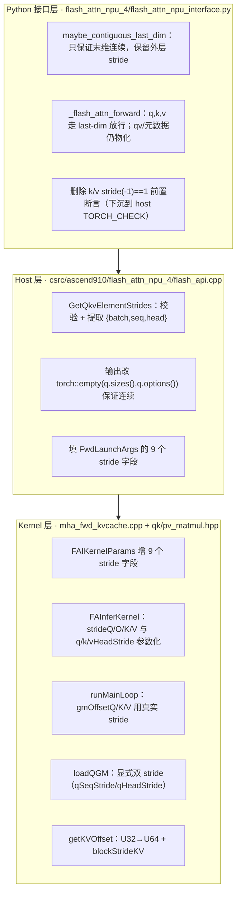
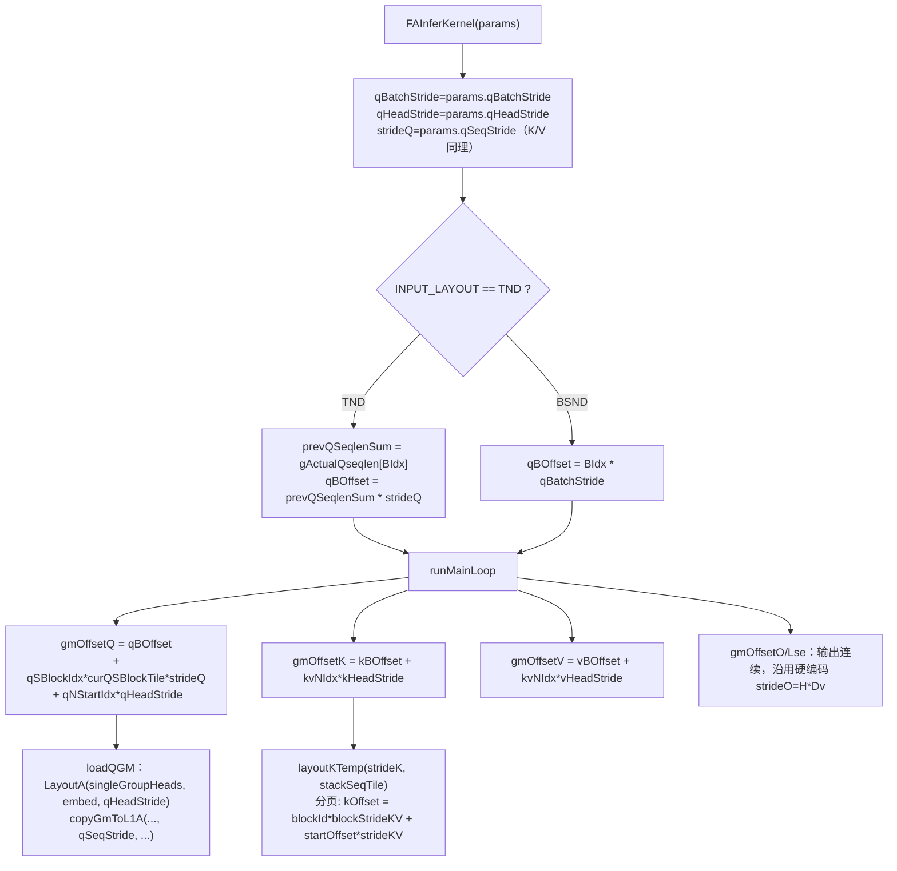
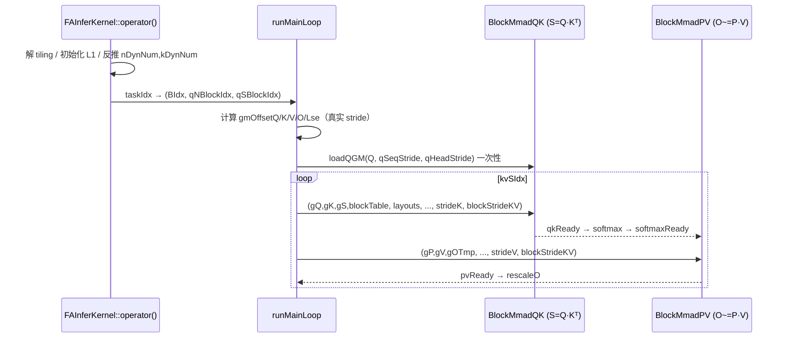
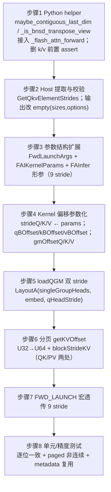

# FA4 前向接口非连续 BSND 布局支持 —— 需求设计文档

> 需求来源：[docs/需求描述.txt](./需求描述.txt)
> 参考实现：`bnsd` 分支 `13cdb09`（"support bnsd demo"，即 demo-pr）
> 参考分析：[PR223_BNSD支持实现方案分析.md](./PR223_BNSD支持实现方案分析.md)、[910_FAInferKernel数据搬运与分块分析.md](./910_FAInferKernel数据搬运与分块分析.md)
> 目标代码：`csrc/ascend910/flash_attn_npu_4/`、`flash_attn_npu_4/`（Ascend 910）
> 编写日期：2026-10-15

---

## 1. 需求概述

### 1.1 背景

昇腾生态常用 **BNSD** `(B, N, S, D)` 布局，而本仓库 FA4 kernel 原生消费 **BSND** `(B, S, N, D)`。
调用方为对齐 NV Dao-AILab 接口，通常将 `(B, N, S, D)` 的 BNSD 张量执行 `transpose(1, 2)`，得到**逻辑形状为 BSND、但内存不连续**的视图（`transpose` 只改 stride 不搬数据）。

当前 FA4 前向接口对输入做**全量 `contiguous()` 物化**，产生 2~4 次额外 D2D 拷贝；长序列 / KV Cache 推理场景下带宽与显存开销显著。

### 1.2 目标

让 FA4 三个前向接口直接**零拷贝消费非连续 BSND 视图**，kernel 按张量真实 stride 计算偏移：

| 接口                        | 文件                                                                                                                            | 说明                          |
| --------------------------- | ------------------------------------------------------------------------------------------------------------------------------- | ----------------------------- |
| `flash_attn_func`         | [flash_attn_npu_interface.py](file:///d:/01code/fancode/261014/flash-attention-npu/flash_attn_npu_4/flash_attn_npu_interface.py) | 稠密 padded 前向              |
| `flash_attn_varlen_func`  | 同上                                                                                                                            | TND / paged KV / kvcache 前向 |
| `flash_attn_with_kvcache` | 同上                                                                                                                            | KV Cache 推理                 |

### 1.3 性能收益

省去一次显式 `contiguous` 拷贝，减少显存占用与带宽开销；对 KV Cache 推理的时延改善尤为明显。

### 1.4 硬件与范围

- **硬件型号：910**（`flash_attn_npu_4`）。
- **范围内**：910 FA4 **前向**（含 paged KV / kvcache 路径）。
- **范围外（本文档不展开实现）**：910 FA4 反向（FAG）strided、950 平台适配。demo-pr 中虽含反向改动，但需求只要求前向接口，反向按现有 `contiguous` 约束保持。

---

## 2. 名词与布局定义

### 2.1 布局

| 布局 | 形状             | 含义                                     |
| ---- | ---------------- | ---------------------------------------- |
| BNSD | `(B, N, S, D)` | batch、head、seq、dim（物理存储）        |
| BSND | `(B, S, N, D)` | batch、seq、head、dim（kernel 逻辑布局） |

`BNSD.transpose(1, 2)` → 逻辑 BSND，stride 为：

```
stride = (N*S*D, D, S*D, 1)
          ^batch   ^seq ^head ^dim
```

### 2.2 关键不变量

- **最后一维（D）必须连续**（`stride(-1) == 1`）——这是 kernel DMA 的最小前提；
- 连续 BSND 下：`seq stride = N*D`、`head stride = D`；
- BNSD 转置视图下二者**互换量级**：`seq stride = D`、`head stride = N*S*D`。
  这正是"单一 `ld` 无法描述 Q"、必须传入**双 stride 标量**的根本原因（见 [910_FAInferKernel数据搬运与分块分析.md §3.7](./910_FAInferKernel数据搬运与分块分析.md)）。

### 2.3 stride 三元组

对 Q/K/V 各自定义元素级 stride 三元组 `{batch, seq, head}`（单位：元素个数）：

| 张量                      | batch stride                      | seq stride | head stride |
| ------------------------- | --------------------------------- | ---------- | ----------- |
| 连续 BSND`(B,S,N,D)`    | `S*N*D`                         | `N*D`    | `D`       |
| BNSD.transpose(1,2) 视图  | `N*S*D`                         | `D`      | `S*D`     |
| paged K/V`(Nb,P,N,D)`   | `P*N*D`（即 page/block stride） | `N*D`    | `D`       |
| TND varlen`(total,N,D)` | `0`（无 batch 维）              | `N*D`    | `D`       |

> paged K/V 的 batch stride 恰好等于 **block（page）stride**，kernel 分页寻址可直接复用 `kBatchStride` 作为 `blockStrideKV`。

---

## 3. 现状与参考实现（demo-pr）分析

### 3.1 910 FA4 前向现状（基线 `main` / 当前 `supportbnsd`）

调用链：Python → `flash_attn_npu_4.fwd`（C++ host）→ `RunOpApiV2` → `launch_fwd<IS_TND>` → `SplitFuse::FAInfer` kernel。

| 层          | 现状                                                                                   | 位置                                                                                                                                                                                                                                                                 |
| ----------- | -------------------------------------------------------------------------------------- | -------------------------------------------------------------------------------------------------------------------------------------------------------------------------------------------------------------------------------------------------------------------- |
| Python      | 前向对 q/k 全量`maybe_contiguous`，v 特殊判断；反向 assert 末维连续                  | [flash_attn_npu_interface.py L39-L41/L123-L124](file:///d:/01code/fancode/261014/flash-attention-npu/flash_attn_npu_4/flash_attn_npu_interface.py#L39-L41)                                                                                                            |
| Host        | `TORCH_CHECK(q.stride(-1)==1)`；输出 `torch::empty_like(q)`；无 stride 提取        | [flash_api.cpp L186-L191](file:///d:/01code/fancode/261014/flash-attention-npu/csrc/ascend910/flash_attn_npu_4/flash_api.cpp#L186-L191)                                                                                                                               |
| Host 参数   | `FwdLaunchArgs` 无 stride 字段                                                       | [fwd_dispatch.hpp L26-L51](file:///d:/01code/fancode/261014/flash-attention-npu/csrc/ascend910/flash_attn_npu_4/fwd_dispatch.hpp#L26-L51)                                                                                                                             |
| Kernel 入参 | `FAIKernelParams` 无 stride 字段                                                     | [kernel_common.hpp](file:///d:/01code/fancode/261014/flash-attention-npu/csrc/ascend910/flash_attn_npu_4/kernel_common.hpp)                                                                                                                                           |
| Kernel 偏移 | `strideQ=qHeads*embed` 等**硬编码**（隐含 head 维连续）                        | [mha_fwd_kvcache.cpp L259-L262](file:///d:/01code/fancode/261014/flash-attention-npu/csrc/ascend910/flash_attn_npu_4/mha_fwd_kvcache.cpp#L259-L262)                                                                                                                   |
| Kernel 偏移 | `gmOffsetQ += qNStartIdx*embed`，`gmOffsetK += kvNIdx*embed`                       | [mha_fwd_kvcache.cpp L519-L526](file:///d:/01code/fancode/261014/flash-attention-npu/csrc/ascend910/flash_attn_npu_4/mha_fwd_kvcache.cpp#L519-L526)                                                                                                                   |
| Q 加载      | `loadQGM` 由 `layoutA.GetTileLayout(...)` 派生，隐含 **head stride = embed** | [qk_matmul.hpp L117-L131](file:///d:/01code/fancode/261014/flash-attention-npu/csrc/ascend910/flash_attn_npu_4/qk_matmul.hpp#L117-L131)                                                                                                                               |
| 分页偏移    | `kOffset = blockTableId*blockSize*strideKV + ...`，U32                               | [qk_matmul.hpp L177](file:///d:/01code/fancode/261014/flash-attention-npu/csrc/ascend910/flash_attn_npu_4/qk_matmul.hpp#L177)、[pv_matmul.hpp L131-L141](file:///d:/01code/fancode/261014/flash-attention-npu/csrc/ascend910/flash_attn_npu_4/pv_matmul.hpp#L131-L141) |

> 注：基线 `main` 中 `runMainLoop` **定义完整存在**（[mha_fwd_kvcache.cpp L445](file:///d:/01code/fancode/261014/flash-attention-npu/csrc/ascend910/flash_attn_npu_4/mha_fwd_kvcache.cpp#L445)）。demo-pr 在合并该特性时出现 bad-merge，导致 v3/v4 的 `runMainLoop` 函数签名丢失、函数体孤悬，**不可编译**（见 §10.1 P0 风险）。

### 3.2 demo-pr 做法（借鉴点）

demo-pr 落地"方案B：kernel 原生支持"，核心是**把 Q/K/V 的 stride 三元组作为 launch 参数逐次传入**，kernel 内 batch/seq/head 偏移全部参数化。三条借鉴点：

1. **stride 与 scheduler_metadata 解耦**：stride 属"本次 launch 的地址元数据"，不写入可复用的 tiling，从而同形状不同视图可共享 metadata 缓存；
2. **`storage().data()` → `data_ptr()`**：修复带 `storage_offset` 视图取址错误，是非连续视图进 kernel 的正确性前提；
3. **偏移量 U32 → U64**：避免大 `B*S*H*D` 下的静默溢出。

同时 demo-pr 存在**必须规避的缺陷**（本设计逐条修正）：

- ❌ 把 `FwdLaunchArgs` 中已有的 `runtimeDevice / seqUsedQDevice / seqUsedKVDevice / blockTableStride` **误删**（bad-merge）；
- ❌ `runMainLoop` 定义丢失、KV 栈循环出现两份重复副本；
- ❌ 分页 `blockStrideKV` 未做 host 侧位宽校验；
- ❌ 未清理参数化版与硬编码版并存的重复偏移计算。

---

## 4. 总体设计

### 4.1 三层改造架构



### 4.2 核心思想

> 把 `{batchStride, seqStride, headStride}` 作为 **kernel launch 参数**逐次传入，kernel 内所有 batch/seq/head 偏移全部参数化；连续输入时这些 stride 恰等于改造前的硬编码值，行为**比特一致**。

### 4.3 关键设计决策

| 决策                                                               | 理由                                                                      |
| ------------------------------------------------------------------ | ------------------------------------------------------------------------- |
| stride 走 launch 参数，不入 scheduler_metadata                     | 保住 metadata 缓存复用（同形状不同视图共享 tiling），CUDA/NPU Graph 友好  |
| 前向放行"末维连续"的**任意 4D 视图**（非仅 BNSD 转置）       | 覆盖面更广；正确性由 host 显式校验（末维连续、无负 stride、DMA 位宽）兜底 |
| 输出/LSE 始终分配为**连续 BSND**                             | 避免输出 scatter；前向输出无"梯度保形"诉求，保持简单                      |
| 保留`blockTableStride`、`runtimeDevice`、`seqUsedQ/KvDevice` | 基线已有且必要，**只增不删**（规避 demo-pr bad-merge 缺陷）         |
| 偏移量 U32 → U64                                                  | 大 batch / 长序列下`B*S*H*D` 溢出是必然场景                             |
| paged 引入`blockStrideKV`                                        | 分页 cache 的页本身也可以是非连续视图（页内 stride ≠ blockSize×stride） |

---

## 5. 数据流与流程图

### 5.1 端到端数据流（BNSD 转置视图 → kernel）

```mermaid
flowchart LR
    A["用户: BNSD (B,N,S,D)"] -->|"transpose(1,2)"| B["BSND 视图<br/>stride=(N*S*D, D, S*D, 1)<br/>非连续、零拷贝"]
    B --> C["Python<br/>maybe_contiguous_last_dim<br/>末维连续→原样下发"]
    C --> D["Host<br/>GetQkvElementStrides<br/>{batch,seq,head}"]
    D --> E["FwdLaunchArgs 9×stride"]
    E --> F["FAInfer kernel<br/>偏移按真实 stride 参数化"]
    F --> G["L1 内落成连续 (rowNum,embed)<br/>DMA 按双 stride 跳读"]
    G --> H["S=Q·Kᵀ → softmax → O~=P·V → rescale"]
    H --> I["连续 BSND 输出 + LSE"]
```



### 5.2 前向 kernel 寻址流程图（改造后）



### 5.3 任务派发 → BlockMmad 调用链（不变部分）



---

## 6. 关键参数定义

### 6.1 Host 侧 `FwdLaunchArgs` 新增字段

文件：[fwd_dispatch.hpp](file:///d:/01code/fancode/261014/flash-attention-npu/csrc/ascend910/flash_attn_npu_4/fwd_dispatch.hpp)

```cpp
// 保留原有字段（blockTableStride / runtimeDevice / sequsedQDevice / sequsedKVDevice），仅追加：
uint64_t qBatchStride, qSeqStride, qHeadStride;
uint64_t kBatchStride, kSeqStride, kHeadStride;
uint64_t vBatchStride, vSeqStride, vHeadStride;
```

### 6.2 Kernel 侧 `FAIKernelParams` 新增字段

文件：[kernel_common.hpp](file:///d:/01code/fancode/261014/flash-attention-npu/csrc/ascend910/flash_attn_npu_4/kernel_common.hpp)

```cpp
// Per-launch element strides are address metadata. They must not be
// cached in scheduler_metadata, which is reusable across tensor views.
uint64_t qBatchStride, qSeqStride, qHeadStride;
uint64_t kBatchStride, kSeqStride, kHeadStride;
uint64_t vBatchStride, vSeqStride, vHeadStride;
```

构造函数按上述顺序追加形参；`FAInfer` 模板函数签名同步追加 9 个 `uint64_t` 形参。

### 6.3 偏移计算公式：改造前 → 改造后对照

| 量                        | 基线（硬编码）                                                    | 改造后（参数化）                                             |
| ------------------------- | ----------------------------------------------------------------- | ------------------------------------------------------------ |
| `strideQ`               | `qHeads * embed`                                                | `params.qSeqStride`                                        |
| `strideK`               | `kvHeads * embed`                                               | `params.kSeqStride`                                        |
| `strideV`               | `kvHeads * embedV`                                              | `params.vSeqStride`                                        |
| `strideO`               | `qHeads * embedV`                                               | **不变**（输出恒连续）                                 |
| `qBOffset`(BSND)        | `BIdx * maxQSeqlen * strideQ`                                   | `BIdx * qBatchStride`                                      |
| `qBOffset`(TND)         | `prevQSeqlenSum * strideQ`                                      | **不变**                                               |
| `kBOffset`(BSND,非分页) | `kvSeqlen0*BIdx * strideK`                                      | `BIdx * kBatchStride`                                      |
| `blockBOffset`(分页)    | `BIdx * blockTableStride`                                       | **不变**（block table 强制连续）                       |
| `gmOffsetQ` head 项     | `qNStartIdx * embed`                                            | `qNStartIdx * qHeadStride`                                 |
| `gmOffsetK` head 项     | `kvNIdx * embed`                                                | `kvNIdx * kHeadStride`                                     |
| `gmOffsetV` head 项     | `kvNIdx * embedV`                                               | `kvNIdx * vHeadStride`                                     |
| 分页`kOffset`           | `blockTableId*blockSize*strideKV + startOffset*strideKV`（U32） | `blockTableId*blockStrideKV + startOffset*strideKV`（U64） |

**退化保证**：连续 BSND 下 `qBatchStride=S*H*D`、`qSeqStride=H*D`、`qHeadStride=D`，代入后与基线逐项相等。

### 6.4 `loadQGM` 双 stride

```cpp
// One ND matrix is a group of heads for one token. qHeadStride describes
// rows within that matrix and qSeqStride separates tokens; this directly
// handles BNSD.transpose(1, 2) without materializing.
LayoutA layoutSingleANd(singleGroupHeads, embed, qHeadStride);
copyGmToL1A(l1ATensor, gA, layoutAInL1, layoutSingleANd,
            tokenNumPerGroup, qSeqStride, tokenNumPerGroup, BLOCK_SIZE, rowNumRound);
```

K 无需新增标量：seq stride 经 `layoutKTemp(strideK, stackSeqTile)` 的 `ld` 通道带入，head/batch stride 走 `gmOffsetK` 偏移通道（K 为 `ColumnMajor`，天然兼容两种布局，见分析文档 §3.10）。

---

## 7. 分层实现设计

### 7.1 Python 接口层

文件：[flash_attn_npu_4/flash_attn_npu_interface.py](file:///d:/01code/fancode/261014/flash-attention-npu/flash_attn_npu_4/flash_attn_npu_interface.py)

新增 helper（前向只需前两个）：

```python
def maybe_contiguous_last_dim(x):
    """Keep Q/K/V outer strides; only the vector dimension must be contiguous."""
    return x.contiguous() if x is not None and x.stride(-1) != 1 else x

def _is_bnsd_transpose_view(x):
    """BSND view produced by BNSD.transpose(1, 2) — stride == (N*S*D, D, S*D, 1)."""
    if x is None or x.dim() != 4 or x.stride(-1) != 1:
        return False
    _, seqlen, nheads, headdim = x.shape
    return x.stride() == (nheads * seqlen * headdim, headdim, seqlen * headdim, 1)
```

接入点：

1. `_flash_attn_forward`：
   - `q, k, v = [maybe_contiguous_last_dim(x) for x in (q, k, v)]`（替换全量 `maybe_contiguous`）；
   - `qv = maybe_contiguous(qv)`（qv 组合张量仍要求全连续）；
   - `cu_seqlens/seqused/page_table` 仍 `maybe_contiguous`。
2. `FlashAttnFunc.forward` / `FlashAttnVarlenFunc.forward`：**删除** `assert k.stride(-1)==1`、`assert v.stride(-1)==1`（末维连续性改由 host `TORCH_CHECK` 承担）。
3. 反向 helper（`maybe_contiguous_bwd/_bwd_output`）本次**不启用**（反向范围外），保持现状。

> paged KV/kvcache 路径：`k_cache`/`v_cache` 形如 `(num_pages, page_size, nheads_k, headdim)`，同样走 `maybe_contiguous_last_dim`，host 提取出 `batchStride=pageStride`。

### 7.2 Host 层

文件：[csrc/ascend910/flash_attn_npu_4/flash_api.cpp](file:///d:/01code/fancode/261014/flash-attention-npu/csrc/ascend910/flash_attn_npu_4/flash_api.cpp)

1. 新增 stride 提取与校验：

```cpp
struct QkvElementStrides { uint64_t batch, seq, head; };

static QkvElementStrides GetQkvElementStrides(const at::Tensor &x, const char *name)
{
    TORCH_CHECK(x.dim() == 3 || x.dim() == 4, name, " must be a 3D TND or 4D BSND/paged tensor");
    TORCH_CHECK(x.stride(x.dim() - 1) == 1, name, " must be contiguous in the last dimension");
    for (int64_t i = 0; i < x.dim(); ++i)
        TORCH_CHECK(x.stride(i) >= 0, name, " does not support negative strides");
    TORCH_CHECK(static_cast<uint64_t>(x.stride(x.dim() - 2)) <= std::numeric_limits<uint32_t>::max(),
                name, " head stride exceeds the kernel DMA limit");
    const int64_t seqDim = x.dim() == 3 ? 0 : 1;
    TORCH_CHECK(static_cast<uint64_t>(x.stride(seqDim)) <= std::numeric_limits<uint32_t>::max(),
                name, " sequence stride exceeds the kernel DMA limit");
    if (x.dim() == 3)  // TND：无 batch 维
        return {0, static_cast<uint64_t>(x.stride(0)), static_cast<uint64_t>(x.stride(1))};
    return {static_cast<uint64_t>(x.stride(0)),
            static_cast<uint64_t>(x.stride(1)),
            static_cast<uint64_t>(x.stride(2))};
}
```

2. `mha_fwd` 中：用 `GetQkvElementStrides` 替换三行 `stride(-1)==1` 断言；
3. 输出分配：`out = torch::empty(q.sizes(), q.options())`（替换 `empty_like`，保证输出为连续 BSND）；`out_` 传入时 `TORCH_CHECK(out.is_contiguous())`；
4. `page_table` 校验放开为 `is_contiguous()`；
5. 填 `fwd_args.qBatchStride/.../vHeadStride`（9 项），**保留** `blockTableStride`/`runtimeDevice`/`sequsedQDevice`/`sequsedKVDevice`；
6. 取址统一 `data_ptr()`（带 `storage_offset` 的视图必需）。

### 7.3 Kernel 层

文件：[mha_fwd_kvcache.cpp](file:///d:/01code/fancode/261014/flash-attention-npu/csrc/ascend910/flash_attn_npu_4/mha_fwd_kvcache.cpp)、[qk_matmul.hpp](file:///d:/01code/fancode/261014/flash-attention-npu/csrc/ascend910/flash_attn_npu_4/qk_matmul.hpp)、[pv_matmul.hpp](file:///d:/01code/fancode/261014/flash-attention-npu/csrc/ascend910/flash_attn_npu_4/pv_matmul.hpp)、[fwd_dispatch_impl.hpp](file:///d:/01code/fancode/261014/flash-attention-npu/csrc/ascend910/flash_attn_npu_4/fwd_dispatch_impl.hpp)

1. **成员变量**（`FAInferKernel` 类）：新增 `qBatchStride/qHeadStride/kBatchStride/kHeadStride/vBatchStride/vHeadStride`（`strideQ/O/K/V` 复用原有成员）；
2. **`__aicore__` 构造/初始化**：`strideQ=params.qSeqStride`、`qHeadStride=params.qHeadStride`…（替换 L259-262 硬编码）；
3. **`runMainLoop`**：
   - BSND 分支 `qBOffset = BIdx*qBatchStride`、`kBOffset = BIdx*kBatchStride`、`vBOffset = BIdx*vBatchStride`；
   - `gmOffsetQ/K/V` 的 head 项改用 `qHeadStride/kHeadStride/vHeadStride`；
   - `gmOffsetO/gmOffsetLse` 不变（输出连续）。
   - **务必保留基线 `runMainLoop` 定义**（[L445](file:///d:/01code/fancode/261014/flash-attention-npu/csrc/ascend910/flash_attn_npu_4/mha_fwd_kvcache.cpp#L445)），只改偏移行，不得整段搬移（规避 demo-pr P0）。
4. **`FAInfer` 入口**：模板函数追加 9 个 stride 形参并透传给 `FAIKernelParams`；
5. **`loadQGM`**：签名追加 `uint32_t qSeqStride, uint32_t qHeadStride`；用 `LayoutA layoutSingleANd(singleGroupHeads, embed, qHeadStride)` 显式构造，`copyGmToL1A` 的 token 步长用 `qSeqStride`；
6. **`getKVOffset`（QK/PV 两处）**：偏移类型 `uint32_t → uint64_t`；分页分支 `blockSize` 参数换成 `blockStrideKV`，公式 `kOffset = blockId*blockStrideKV + startOffset*strideKV`；
7. **`BlockMmadQK/PV::operator()`**：新增 `uint64_t blockStrideKV` 形参并向下透传；调用点传入 `kBatchStride`/`vBatchStride`（paged 时即 page stride）；
8. **`FWD_LAUNCH` 宏**：launch 实参追加 9 个 stride（注意保持 `runtimeDevice/blockTableStride/sequsedQ/sequsedKV` 实参不变）。

---

## 8. 关键实施步骤



| 步 | 动作                             | 产出/验收                                       |
| -- | -------------------------------- | ----------------------------------------------- |
| 1  | Python helper + 接入             | 连续输入行为不变；非连续视图不再被物化          |
| 2  | Host stride 提取/校验 + 输出连续 | 非法 stride 报可读错误；输出`is_contiguous()` |
| 3  | 结构体/宏形参扩展                | 编译通过（模板形参与实参一一对应）              |
| 4  | Kernel 偏移参数化                | 连续 BSND 下`gmOffset*` 与基线逐项相等        |
| 5  | `loadQGM` 双 stride            | BNSD 转置视图 Q 正确落 L1                       |
| 6  | 分页 U64 + blockStride           | 大 batch / 非连续页正确寻址                     |
| 7  | launch 宏透传                    | 端到端跑通                                      |
| 8  | 测试                             | 见 §9                                          |

---

## 9. 测试与验证方案

| 用例                                                      | 目标                                          | 判据                                  |
| --------------------------------------------------------- | --------------------------------------------- | ------------------------------------- |
| `test_flash_attn_func_accepts_noncontiguous_bshd`       | BNSD.transpose(1,2) 前向 vs 连续版            | `rtol=0, atol=0` **逐位一致** |
| `test_paged_kv_accepts_native_outer_strides`            | q + paged KV 均为非连续视图                   | 先断言零拷贝放行，再逐位一致          |
| `test_paged_kv_native_strides_reuse_scheduler_metadata` | 同形状不同视图复用同一 metadata               | 复用成功且结果一致                    |
| kvcache 回归改造                                          | `(nb, Hk, bs, D).transpose(1,2)` 构造 cache | 既有 kvcache 用例改走转置视图后仍通过 |
| 大形状边界                                                | `B*S*H*D` 接近/超 32 位                     | U64 偏移下无溢出、无静默错误          |

> 测试输入从"天生连续"改为"真实用户场景的转置视图"，使整条 strided 链路默认被回归覆盖。

---

## 10. 边界与风险

### 10.1 P0（必须规避）

| 风险                     | 说明                                                              | 规避                                                                                      |
| ------------------------ | ----------------------------------------------------------------- | ----------------------------------------------------------------------------------------- |
| `runMainLoop` 定义丢失 | demo-pr bad-merge 使 v3/v4 函数签名消失、函数体孤悬、无法编译     | 在基线完整文件上**只改偏移行**，不做整段搬移；改后确认 `runMainLoop` 定义唯一存在 |
| 误删既有 launch 字段     | demo-pr 丢掉`blockTableStride/runtimeDevice/sequsedQ/seqUsedKV` | 结构体与 launch 实参**只增不删**                                                    |
| 两套偏移并存             | 参数化版与硬编码版重复                                            | 改造后统一走`params.*Stride`，删除残留硬编码                                            |

### 10.2 P1 / P2

| 项                 | 说明                                                 | 处理                                                                |
| ------------------ | ---------------------------------------------------- | ------------------------------------------------------------------- |
| DMA 位宽限制       | head/seq stride 必须 ≤`uint32_max`                | host`GetQkvElementStrides` 显式 `TORCH_CHECK`（§7.2）          |
| 反向 varlen 非连续 | 反向仅覆盖 padded-batch / 转置视图白名单             | 本次前向范围外，保持现状                                            |
| 泛化视图           | 前向放行任意末维连续视图，但反向仅识别标准 BNSD 转置 | 文档化边界；`_is_bnsd_transpose_view` 精确匹配，其余回落物化      |
| 多版本同步漂移     | v2/v3/v4 + 950 共 5 套 matmul                        | 本次仅改 910 v4；其余版本如同步需逐一核对，长期抽取公共 stride 结构 |

---

## 11. 文件变更清单（910 FA4 前向）

| 文件                                                                                                                                                               | 变更内容                                                                                                          |
| ------------------------------------------------------------------------------------------------------------------------------------------------------------------ | ----------------------------------------------------------------------------------------------------------------- |
| [flash_attn_npu_4/flash_attn_npu_interface.py](file:///d:/01code/fancode/261014/flash-attention-npu/flash_attn_npu_4/flash_attn_npu_interface.py)                   | 新增`maybe_contiguous_last_dim` / `_is_bnsd_transpose_view`；`_flash_attn_forward` 接入；删 k/v 前置 assert |
| [csrc/ascend910/flash_attn_npu_4/flash_api.cpp](file:///d:/01code/fancode/261014/flash-attention-npu/csrc/ascend910/flash_attn_npu_4/flash_api.cpp)                 | `GetQkvElementStrides`；输出改 `empty(sizes,options)`；填 9 stride；`data_ptr()`                            |
| [csrc/ascend910/flash_attn_npu_4/fwd_dispatch.hpp](file:///d:/01code/fancode/261014/flash-attention-npu/csrc/ascend910/flash_attn_npu_4/fwd_dispatch.hpp)           | `FwdLaunchArgs` +9 stride                                                                                       |
| [csrc/ascend910/flash_attn_npu_4/fwd_dispatch_impl.hpp](file:///d:/01code/fancode/261014/flash-attention-npu/csrc/ascend910/flash_attn_npu_4/fwd_dispatch_impl.hpp) | `FWD_LAUNCH` 宏追加 9 实参                                                                                      |
| [csrc/ascend910/flash_attn_npu_4/kernel_common.hpp](file:///d:/01code/fancode/261014/flash-attention-npu/csrc/ascend910/flash_attn_npu_4/kernel_common.hpp)         | `FAIKernelParams` +9 stride                                                                                     |
| [csrc/ascend910/flash_attn_npu_4/mha_fwd_kvcache.cpp](file:///d:/01code/fancode/261014/flash-attention-npu/csrc/ascend910/flash_attn_npu_4/mha_fwd_kvcache.cpp)     | `FAInfer` 形参、成员赋值、`runMainLoop` 偏移参数化                                                            |
| [csrc/ascend910/flash_attn_npu_4/qk_matmul.hpp](file:///d:/01code/fancode/261014/flash-attention-npu/csrc/ascend910/flash_attn_npu_4/qk_matmul.hpp)                 | `loadQGM` 双 stride；`getKVOffset` U64 + `blockStrideKV`；`operator()` +`blockStrideKV`                 |
| [csrc/ascend910/flash_attn_npu_4/pv_matmul.hpp](file:///d:/01code/fancode/261014/flash-attention-npu/csrc/ascend910/flash_attn_npu_4/pv_matmul.hpp)                 | `getKVOffset` U64 + `blockStrideKV`；`operator()` +`blockStrideKV`                                        |
| tests/test_flash_attn_npu_v4.py                                                                                                                                    | 新增 3 个非连续用例 + kvcache BNSD 化                                                                             |

---

## 附录 A：代码改动清单（可直接施工）

> 行号基于当前基线 `supportbnsd`（= `main` `e378fb3`）。改动原则：**只增不删**，先扩参数结构、再加 Host 填充、最后改 Kernel 偏移，保证每步可编译。

### A.1 步骤 1 — Python 接口层

文件：[flash_attn_npu_4/flash_attn_npu_interface.py](file:///d:/01code/fancode/261014/flash-attention-npu/flash_attn_npu_4/flash_attn_npu_interface.py)

| #    | 函数 / 位置                     | 行号    | 改动内容                                                                                                                                                      |
| ---- | ------------------------------- | ------- | ------------------------------------------------------------------------------------------------------------------------------------------------------------- |
| PY-1 | 模块级 helper                   | 39-41   | 保留`maybe_contiguous`；**新增** `maybe_contiguous_last_dim(x)`（末维连续则原样返回）                                                               |
| PY-2 | 模块级 helper                   | 39 附近 | **新增** `_is_bnsd_transpose_view(x)`（stride == `(N*S*D, D, S*D, 1)`）；本步仅前向使用，供后续反向/单测复用                                        |
| PY-3 | `_flash_attn_forward`         | 123-124 | `q,k = maybe_contiguous(...)`、v 特殊判断 → 统一替换为 `q, k, v = [maybe_contiguous_last_dim(x) for x in (q, k, v)]`；新增 `qv = maybe_contiguous(qv)` |
| PY-4 | `_flash_attn_forward`         | 125-127 | `cu_seqlens_*` / `seqused_*` / `page_table` 保持 `maybe_contiguous`（**不动**）                                                                 |
| PY-5 | `FlashAttnFunc.forward`       | 626-627 | **删除** `assert k.stride(-1)==1` / `assert v.stride(-1)==1`                                                                                        |
| PY-6 | `FlashAttnVarlenFunc.forward` | 810-811 | **删除** `assert k.stride(-1)==1` / `assert v.stride(-1)==1`（kvcache 路径同样放行）                                                                |

### A.2 步骤 2 — Host 层

文件：[csrc/ascend910/flash_attn_npu_4/flash_api.cpp](file:///d:/01code/fancode/261014/flash-attention-npu/csrc/ascend910/flash_attn_npu_4/flash_api.cpp)

| #   | 函数 / 位置                   | 行号    | 改动内容                                                                                                                                                                                                                                                 |
| --- | ----------------------------- | ------- | -------------------------------------------------------------------------------------------------------------------------------------------------------------------------------------------------------------------------------------------------------- |
| H-1 | 文件级（`mha_fwd` 之前）    | —      | **新增** `struct QkvElementStrides {uint64_t batch, seq, head;}` 与 `static QkvElementStrides GetQkvElementStrides(const at::Tensor&, const char*)`（校验：3D/4D、末维连续、非负 stride、head/seq stride ≤ UINT32_MAX 且 ≤ UINT32_MAX/elem） |
| H-2 | `mha_fwd`                   | 132-134 | 三行`TORCH_CHECK(q/k/v.stride(-1)==1)` → `const auto qStrides = GetQkvElementStrides(q,"q");`（k/v 同）                                                                                                                                             |
| H-3 | `mha_fwd`                   | 148     | `page_table.stride(-1)==1` → `page_table.is_contiguous()`                                                                                                                                                                                           |
| H-4 | `mha_fwd`                   | 188-190 | `TORCH_CHECK(out.stride(-1)==1)` → `TORCH_CHECK(out.is_contiguous())`；`out = torch::empty_like(q)` → `out = torch::empty(q.sizes(), q.options())`                                                                                             |
| H-5 | `mha_fwd`                   | 581-583 | 取址统一`q.data_ptr()` / `k.data_ptr()` / `v.data_ptr()`（替换 `storage().data()`；`out`/`block_table` 同）                                                                                                                                  |
| H-6 | `mha_fwd` `fwd_args` 填充 | 609-621 | **追加** 9 行：`fwd_args.qBatchStride=qStrides.batch; ... fwd_args.vHeadStride=vStrides.head;`；**保留** `blockTableStride`(614) / `runtimeDevice`(621) / `sequsedQ/KVDevice`(607-608)                                               |

### A.3 步骤 3 — 参数结构扩展（10 处形参 + 9 处实参）

| #   | 文件                                                                                                                               | 函数 / 结构                                    | 行号    | 改动内容                                                                                                                                                                        |
| --- | ---------------------------------------------------------------------------------------------------------------------------------- | ---------------------------------------------- | ------- | ------------------------------------------------------------------------------------------------------------------------------------------------------------------------------- |
| S-1 | [fwd_dispatch.hpp](file:///d:/01code/fancode/261014/flash-attention-npu/csrc/ascend910/flash_attn_npu_4/fwd_dispatch.hpp)           | `struct FwdLaunchArgs`                       | 43-50   | 在末尾**追加** 9 个 `uint64_t` stride 字段（q/k/v × batch/seq/head）                                                                                                   |
| S-2 | [kernel_common.hpp](file:///d:/01code/fancode/261014/flash-attention-npu/csrc/ascend910/flash_attn_npu_4/kernel_common.hpp)         | `struct FAIKernelParams`                     | 61-88   | 字段区追加 9 个`uint64_t`；默认构造(78)不动；带参构造(80)形参追加 9 个并加入初始化列表                                                                                        |
| S-3 | [mha_fwd_kvcache.cpp](file:///d:/01code/fancode/261014/flash-attention-npu/csrc/ascend910/flash_attn_npu_4/mha_fwd_kvcache.cpp)     | `FAInfer` 模板函数                           | 869-877 | 形参追加 9 个`uint64_t`（`qBatchStride..vHeadStride`）                                                                                                                      |
| S-4 | 同上                                                                                                                               | `FAInfer` 内 `FAIKernelParams params{...}` | 930-931 | 聚合初始化追加 9 个实参（顺序与 S-2 严格一致）                                                                                                                                  |
| S-5 | [fwd_dispatch_impl.hpp](file:///d:/01code/fancode/261014/flash-attention-npu/csrc/ascend910/flash_attn_npu_4/fwd_dispatch_impl.hpp) | `FWD_LAUNCH` 宏                              | 24-30   | `<<<...>>>` 实参末尾追加 `a.qBatchStride..a.vHeadStride`；**保留** `a.runtimeDevice` / `a.blockTableStride` / `a.sequsedQDevice` / `a.sequsedKVDevice` 原实参 |

### A.4 步骤 4 — Kernel 成员与偏移参数化

文件：[mha_fwd_kvcache.cpp](file:///d:/01code/fancode/261014/flash-attention-npu/csrc/ascend910/flash_attn_npu_4/mha_fwd_kvcache.cpp)

| #   | 函数 / 位置                            | 行号    | 改动内容                                                                                                                                                                                                                                              |
| --- | -------------------------------------- | ------- | ----------------------------------------------------------------------------------------------------------------------------------------------------------------------------------------------------------------------------------------------------- |
| K-1 | `FAInferKernel` 成员声明             | 844-847 | 在`strideQ/O/K/V` 旁**追加** `uint64_t qBatchStride,qHeadStride,kBatchStride,kHeadStride,vBatchStride,vHeadStride;`                                                                                                                         |
| K-2 | `FAInferKernel::operator()` 初始化段 | 259-262 | `strideQ=qHeads*embed` 等 4 行 → `strideQ=params.qSeqStride; qHeadStride=params.qHeadStride; qBatchStride=params.qBatchStride;`（K/V 同）；`strideO` **保持** `qHeads*embedV`                                                          |
| K-3 | `runMainLoop` 起址计算               | 482-492 | BSND 分支：`qBOffset=BIdx*qBatchStride`；`kBOffset=BIdx*kBatchStride`（非分页）；`vBOffset=BIdx*vBatchStride`；TND 分支保持 `prevQSeqlenSum*strideQ`；`blockBOffset=BIdx*blockTableStride`(490) **不变**；`oBOffset` **不变** |
| K-4 | `runMainLoop` head 偏移              | 519-522 | `gmOffsetQ` 的 `qNStartIdx*embed` → `*qHeadStride`；`gmOffsetK` 的 `kvNIdx*embed` → `*kHeadStride`；`gmOffsetV` 的 `kvNIdx*embedV` → `*vHeadStride`；`gmOffsetO`(523-524) / `gmOffsetLse`(525-526) **不变**            |
| K-5 | ——                                   | L445    | **保持** `runMainLoop` 函数签名与定义完整（只改上述偏移行，禁止整段搬移/重复）                                                                                                                                                                |

### A.5 步骤 5 — Q 加载双 stride

文件：[qk_matmul.hpp](file:///d:/01code/fancode/261014/flash-attention-npu/csrc/ascend910/flash_attn_npu_4/qk_matmul.hpp)

| #   | 函数 / 位置                   | 行号    | 改动内容                                                                                                                                                                    |
| --- | ----------------------------- | ------- | --------------------------------------------------------------------------------------------------------------------------------------------------------------------------- |
| Q-1 | `BlockMmadQK::loadQGM` 签名 | 117-120 | `..., uint32_t rowNum, uint32_t &singleGroupHeads, uint32_t &qHeads)` → `..., uint32_t rowNum, uint32_t &singleGroupHeads, uint32_t qSeqStride, uint32_t qHeadStride)` |
| Q-2 | `loadQGM` 体                | 125     | `auto layoutSingleANd = layoutA.GetTileLayout(MakeCoord(singleGroupHeads, embed));` → `LayoutA layoutSingleANd(singleGroupHeads, embed, qHeadStride);`                 |
| Q-3 | `loadQGM` 体                | 127-131 | `copyGmToL1A(..., tokenNumPerGroup, qHeads*embed, ...)` 的第二个 stride 实参 → `qSeqStride`                                                                            |
| Q-4 | `runMainLoop` 调用点        | 635     | `loadQGM(gQ[gmOffsetQ], layoutQTemp, rowNum, qNBlockSize, qHeads)` → 末位追加 `static_cast<uint32_t>(strideQ), static_cast<uint32_t>(qHeadStride)`                     |

### A.6 步骤 6 — 分页 getKVOffset（U32→U64 + blockStrideKV）

| #   | 文件                                                                                                                           | 函数                           | 行号              | 改动内容                                                                                                                                                     |
| --- | ------------------------------------------------------------------------------------------------------------------------------ | ------------------------------ | ----------------- | ------------------------------------------------------------------------------------------------------------------------------------------------------------ |
| P-1 | [qk_matmul.hpp](file:///d:/01code/fancode/261014/flash-attention-npu/csrc/ascend910/flash_attn_npu_4/qk_matmul.hpp)             | `getKVOffset`(非分页)        | 171               | `uint32_t &kOffset` → `uint64_t &kOffset`；`nIdx*maxKVStackLen*strideKV` 提升为 U64 运算                                                              |
| P-2 | 同上                                                                                                                           | `getKVOffset`(分页)          | 177-181           | 末参`uint32_t blockSize` → `uint64_t blockStrideKV`；公式 → `kOffset = (uint64_t)blockTableId*blockStrideKV + (uint64_t)startOffset*strideKV`        |
| P-3 | 同上                                                                                                                           | `BlockMmadQK::operator()`    | 202-210           | 形参追加`uint64_t blockStrideKV`；`uint32_t gBOffset` → `uint64_t gBOffset`；两处 `getKVOffset` 调用同步改传 `blockStrideKV`                      |
| P-4 | [pv_matmul.hpp](file:///d:/01code/fancode/261014/flash-attention-npu/csrc/ascend910/flash_attn_npu_4/pv_matmul.hpp)             | `getKVOffset`(非分页/分页)   | 131-141           | 同 P-1 / P-2                                                                                                                                                 |
| P-5 | 同上                                                                                                                           | `BlockMmadPV::operator()`    | 171-177           | 形参追加`uint64_t blockStrideKV`；`uint32_t gBOffset` → `uint64_t`；调用(199/209)同步                                                                 |
| P-6 | [mha_fwd_kvcache.cpp](file:///d:/01code/fancode/261014/flash-attention-npu/csrc/ascend910/flash_attn_npu_4/mha_fwd_kvcache.cpp) | `runMainLoop` 调用 BlockMmad | 651-657 / 777-783 | `blockMmadQK(...)` 末位追加 `kBatchStride`；`blockMmadPV(...)` 末位追加 `vBatchStride`（paged 时即 page stride）；分支（paged / 非 paged）两处都要改 |

### A.7 步骤 7 — 测试（`tests/test_flash_attn_npu_v4.py`）

| #   | 用例                                                          | 改动内容                                                                        |
| --- | ------------------------------------------------------------- | ------------------------------------------------------------------------------- |
| T-1 | 新增`test_flash_attn_func_accepts_noncontiguous_bshd`       | BNSD 存储 →`transpose(1,2)` 视图，前向 vs 连续版 `rtol=0, atol=0` 逐位一致 |
| T-2 | 新增`test_paged_kv_accepts_native_outer_strides`            | `(nb, Hk, bs, D).transpose(1,2)` 构造 cache，先断言零拷贝放行，再逐位一致     |
| T-3 | 新增`test_paged_kv_native_strides_reuse_scheduler_metadata` | 同形状不同视图复用同一`scheduler_metadata`，结果一致                          |
| T-4 | 改造既有 kvcache 用例                                         | BSND 构造改为"BNSD 存储 +`transpose(1,2)`"，使 strided 链路默认被覆盖         |

### A.8 施工顺序与自检点


| 自检点         | 期望                                                                  |
| -------------- | --------------------------------------------------------------------- |
| 编译           | 形参/实参数量一一对应；`FAIKernelParams` 聚合初始化顺序与结构体一致 |
| 连续 BSND 回归 | `gmOffset*` 与基线逐项相等；既有用例无回归                          |
| 非连续单测     | `rtol=0` 逐位一致                                                   |
| 分页大形状     | U64 偏移无溢出；`blockStrideKV` 正确取 page stride                  |
| 完整性         | `runMainLoop` 定义唯一；无硬编码 stride 残留；无字段被误删          |
